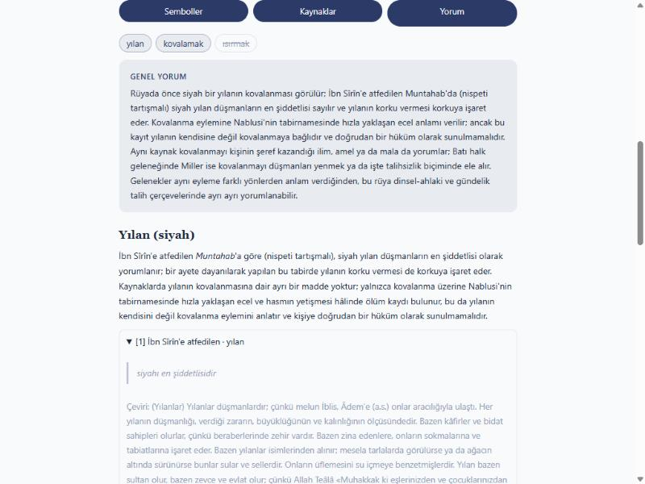
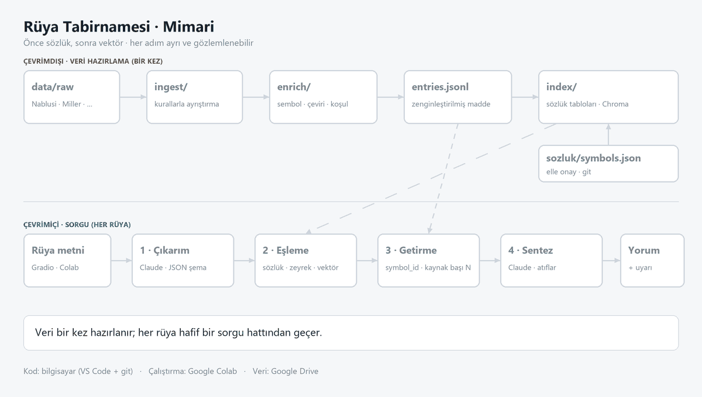

# Rüya Tabirnamesi · Çok Kaynaklı Türkçe RAG

Anlattığın rüyadaki sembolleri bulan, her sembol için klasik tabirnamelerin (Nablusi, İbn Sirin'e atfedilen *Muntahab*) ve Batı kaynaklarının (Miller, Freud) ne dediğini getiren, sonra bunları **kaynak göstererek ve çelişkileri gizlemeden** Türkçe bir yorumda birleştiren kişisel bir öğrenme projesi.

> **Durum (7 Kasım 2026):** Dört kaynak (10.801 madde) çevrildi ve ayrıştırıldı; boru hattı, hibrit getirme, OCR ve arayüz çalışıyor. Sözlük 143 sembol. MVP kabul ölçütleri sağlandı ([01](docs/01-gereksinimler.md)).
> **Bilinen sorun:** Bir rüya medyan 177 saniye sürüyor; hedef 30 saniye. Sözlük, test seti ve çevirilerin gözden geçirilmesi bekliyor ([takvim](docs/08-yol-haritasi-takvim.md)).
> **Projeyi baştan öğrenmek için:** [14 · Ders notu](docs/14-ders-notu.md).



## Belgeler

| # | Belge | İçerik |
|---|---|---|
| 00 | [Proje vizyonu](docs/00-proje-vizyonu.md) | Ne, neden; hedefler, hedef olmayanlar, anti-hedefler |
| 01 | [Gereksinimler](docs/01-gereksinimler.md) | İşlevsel ve işlevsel olmayan gereksinimler, MVP kabul ölçütleri |
| 02 | [Veri kaynakları ve şema](docs/02-veri-kaynaklari-ve-semasi.md) | Seçilen kaynaklar, gerçek veride görülenler, veri hattı, şemalar, çeviri stratejisi |
| 03 | [Mimari](docs/03-mimari.md) | Boru hattı, bileşenler, klasör yapısı, hata yönetimi, test stratejisi |
| 04 | [Teknoloji seçimi](docs/04-teknoloji-secimi.md) | Her teknoloji kararı ve gerekçesi (TK-01 … TK-13) |
| 05 | [Yorum yöntemi](docs/05-yorum-yontemi.md) | Klasik tabirin beş katmanı ve sentez kuralları |
| 06 | [Değerlendirme](docs/06-degerlendirme.md) | Test seti, ölçütler, hedefler, deneyler |
| 07 | [Etik ve hukuk](docs/07-etik-ve-hukuk.md) | Veri ve telif kuralları, yorum dili, uyarı metni, KVKK |
| 08 | [Yol haritası ve takvim](docs/08-yol-haritasi-takvim.md) | 12 haftalık plan, kilometre taşları ([.ics](docs/takvim.ics)) |
| 09 | [Riskler ve açık sorular](docs/09-riskler-ve-acik-sorular.md) | Senin cevaplaman gereken sorular, risk kaydı |
| 10 | [Kurulum rehberi](docs/10-kurulum-rehberi.md) | API anahtarı, uv, kaynakları indirme |
| 11 | [Çalışma ortamı](docs/11-calisma-ortami.md) | Kod, çalıştırma ve veri bilgisayarda; veri `data/` altında, git'e girmez |
| 12 | [Kod yapısı ve sözleşmeler](docs/12-kod-yapisi-ve-sozlesmeler.md) | Katmanlar, modül imzaları, veri ürünleri, adlandırma, geliştirme döngüsü |
| 13 | [Hibrit getirme](docs/13-hibrit-getirme.md) | BM25, vektör, HyDE, RRF, reranker; araştırma ve kararlar |
| 14 | [Ders notu](docs/14-ders-notu.md) | Projeyi baştan sona ders gibi anlatır: RAG kavramları, veri hattı, bir rüyanın yolculuğu, ölçme, dersler |
| 15 | [Kalan işler planı](docs/15-kalan-isler-plani.md) | 10 Kasım sonrası iş sırası, kritik kararlar, deney planı |
| 16 | [Arayüz yenileme planı](docs/16-arayuz-plani.md) | Sade arayüz tasarımı, arayüz metinleri, uygulama adımları |
| 17 | [Kapanış planı](docs/17-kapanis-plani.md) | Son sonuçlar, `v1.0` öncesi işler |
| — | [Kaynaklar](docs/KAYNAKLAR.md) | Künyeler, lisanslar, atıf metinleri |
| — | [Terimler](docs/terimler.md) | Çeviride kullanılan tabir terimleri |
| — | [Kurallar](docs/kurallar.md) | Okuma notların (şablon, Hafta 3) |
| — | [Ölçümler](docs/olcumler.md) · [Deneyler](docs/deneyler/) | Ölçüm özet tablosu, deney notları |
| — | [Araştırma](docs/arastirma/) | Kaynak araştırması: rapor ve 5 ayrıntılı not |

## Kısaca mimari



```
Rüya metni
  → 1. Sembol çıkarımı   (DeepSeek · JSON şeması)
  → 2. Eşleme            (sözlük + zeyrek · yoksa serbest arama)
  → 3. Hibrit getirme    (sözlük + BM25 + vektör + HyDE → RRF → reranker ve eşik · bağlam koşulları)
  → 4. Sentez            (DeepSeek · sembol başına paralel istek + kısa genel yorum · kodda atıf doğrulama)
  → Kaynaklı, gelenek etiketli Türkçe yorum + uyarı
```

## Ölçümler

| Tarih | Ne değişti | Rüya | Sembol recall | Precision | Atıf kapsamı | Medyan süre |
|---|---|---|---|---|---|---|
| 2 Kasım | İlk uçtan uca ölçüm | 20 | %63 | %100 | %40 | ~538 sn (ort.) |
| 2 Kasım | Sentez talimatı v2 | 20 | %77 | %100 | %100 | — |
| 5 Kasım | Düşünme kapalı, hibrit getirme | 45 | %78 | %86 | %100 | 177 sn |
| 6 Kasım | Çıkarım talimatı v3, eşleme düzeltmeleri | 45 | %96 | %87 | %100 | — |
| 10 Kasım | Çıkarım v4, paralel sentez, genel yorum | 45 | %96 | %87 | %100 | 165 sn |

Bütün ölçümlerde olumsuzlama hatası ve yasak ifade 0. Arayüz yorumu geldikçe gösterir: semboller birkaç saniyede, sembol yorumları hazır oldukça. Deneyler: kaynak başına 1 madde (D3) ve sentezde `deepseek-v4.1-flash` (D4) kalıyor; vektör kolu ve reranker deneyleri (D1/D2) etiket bekliyor. Test seti sentetik ve gözden geçirilmedi; precision'daki "fazla" sembollerin çoğu rüyada gerçekten geçiyor. Ayrıntı: [olcumler](docs/olcumler.md).

## Öğrendiklerim

- **Getirme kötüyse üretim de kötüdür.** Emeğin çoğu aramaya gitti: sözlük, BM25, vektör, HyDE, RRF, reranker ve eşik birlikte.
- **Modele güvenme, denetle.** Atıflar kodda doğrulanıyor; verilmemiş maddeye atıf atılıyor.
- **Kesin eşleme gereken yerde kural.** Sembolleri vektörle eşlemek "yılan"ı `akrep`e bağladı; kapatıldı.
- **Model ayarı göründüğünden önemli.** Düşünme adımını kapatmak yanıtı dakikalardan saniyelere indirdi.
- **Ölçütün değeri test setinin kalitesi kadardır.** Precision düşük göründü, çünkü beklenen listeler eksikti.
- **Talimat örneklerine test cümlesi koyma.** Ölçüm ezberi ölçer.
- **Süreyi önce ölç, sonra kısalt.** Sentezi sembol başına paralel isteklere bölmek süreyi %40 kısalttı; çıkarım talimatını kısaltmak ise geçidin dalgalanması yanında kayboldu ve recall'ı düşürdü.
- **Paylaşılan sınırlar ölçümü bozar.** Aynı hesabın 4 eşzamanlı istek sınırını ölçüm ve kod yazan agent'lar birlikte kullanınca rüyalar 429 ile düştü.

Denenip vazgeçilenlerin tamamı: [14 · Ders notu](docs/14-ders-notu.md), bölüm 11.

**Ortam:** Her şey bilgisayarda (VS Code + Git + uv) · veri `data/` altında, git'e girmez

**Teknolojiler:** Python ≥3.11 · EVREN LLM geçidi (`deepseek-v4.1-flash`, `qwen3-embedding-8b`, `qwen3-reranker-8b`, `deepseek-ocr-2`, httpx) · numpy · kendi BM25'imiz · zeyrek · Gradio · pytest · ruff · nbstripout

## Repo düzeni

```
src/ruya/     paket: config, schemas, llm, ingest, enrich, index, pipeline, degerlendirme
notebooks/    ince notebook'lar: deneyler ve inceleme (VS Code, .venv çekirdeği)
prompts/      sürümlü sistem talimatları
sozluk/       elle onaylanan sembol sözlüğü (symbols.json)
app/ eval/ scripts/   giriş noktaları: Gradio arayüzü, değerlendirme, kaynak indirme
tests/        verisiz birim testleri, mimari testleri, kontrat testleri
```

## Bilgisayarda (verisiz) çalıştırma

```powershell
uv sync
uv run nbstripout --install
uv run pytest
uv run ruff check .
```

Veriyle çalıştırma (anahtar ve `data/` gerekir):

```powershell
uv run python scripts/download_sources.py    # ham kaynaklar data/raw altına, bir kez
uv run python scripts/nltk_kur.py            # kök bulma verisi, bir kez
uv run python scripts/maddeleri_kur.py       # data/processed/entries.jsonl
uv run python scripts/hibrit_indeks_kur.py   # data/index/hibrit, yaklaşık 11 dakika
uv run python scripts/ruya_dene.py "Rüyamda yılan gördüm"
uv run python scripts/arayuz_ac.py           # yalnız localhost
uv run python eval/run_eval.py --dataset eval/dataset/ruyalar_v1.jsonl --etiket deneme   # ölçüm, uzun sürer
```

Kurulum ve çalıştırma: [10](docs/10-kurulum-rehberi.md), [11](docs/11-calisma-ortami.md). Hibrit getirmenin tasarımı: [13](docs/13-hibrit-getirme.md).

## Lisans notu

Kod sana aittir. Veri `data/` klasöründe durur ve git'e eklenmez. OpenITI metinleri CC BY-NC-SA 4.0 lisanslıdır; Gutenberg metinleri kamu malıdır. Ayrıntılar: [07-etik-ve-hukuk.md](docs/07-etik-ve-hukuk.md), künyeler: [KAYNAKLAR.md](docs/KAYNAKLAR.md).
