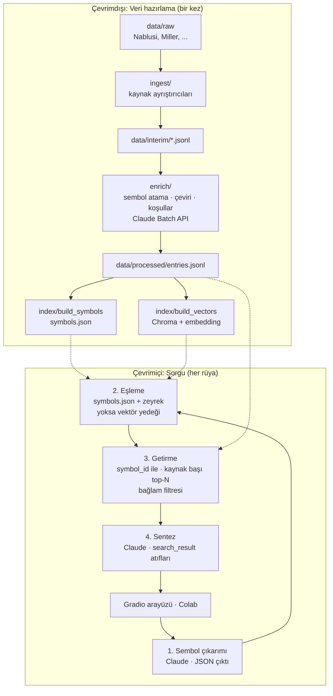

# 03 · Yazılım Mimarisi

> Durum: Taslak v0.1 · Tarih: 21 Ekim 2026
> Teknoloji kararlarının gerekçeleri: [04-teknoloji-secimi.md](04-teknoloji-secimi.md)
> Çalışma ortamı (Colab, Drive, GitHub): [11-calisma-ortami-colab-drive.md](11-calisma-ortami-colab-drive.md)

## 1. Temel tasarım ilkeleri

1. **Önce sözlük, sonra vektör.** Rüya tabiri bir "belgede arama" problemi değil, bir "sözlükte sembol bulma" problemi. Kesin eşleme (sembol kimliği) birincil yol. Vektör arama yalnızca eşleşmeyen semboller için yedek.
2. **Her adım ayrı ve gözlemlenebilir.** Boru hattı dört saf adımdan oluşuyor. Her adımın girdisi ve çıktısı bir veri sınıfı. Hata ayıklama ekranı her adımın çıktısını gösterir.
3. **LLM yalnızca gerektiği yerde.** Ayrıştırma, eşleme ve getirme deterministik kod. LLM üç işte kullanılıyor: sembol çıkarma, sentez ve (çevrimdışı) zenginleştirme.
4. **Çevrimdışı ve çevrimiçi iş ayrı.** Veri hazırlama (çeviri, koşul ayrıştırma) bir kez ve toplu yapılır. Sorgu anındaki iş hafif tutulur.
5. **Kaynak her yerde taşınır.** Her kayıt, `kaynak`, `lisans` ve `konum` bilgisini boru hattının sonuna kadar götürür.
6. **Framework yok.** Düz Python ve az sayıda kütüphane kullanılır. Amaç her katmanı görerek öğrenmek.

## 2. Sistem görünümü



## 3. Sorgu boru hattı: adım adım

### Adım 1 · Sembol çıkarımı (`pipeline/extract.py`)

- **Girdi:** `RuyaGirdisi(metin: str, baglam: Baglam | None)`
- **Çıktı:** `CikarimSonucu(semboller: list[Sembol], ruya_turu_ipucu: str | None)`
  - `Sembol(yalin, nitelikler, eylem, duygu, olumsuz: bool, ham_ifade)`
- **Nasıl:** Claude çağrısı, yapılandırılmış çıktıyla (`output_config.format` ve JSON şeması). Düşük `effort` kullanılır, çünkü bu basit bir çıkarım işi.
- **Kurallar:** Semboller yalın hâlde ve küçük harfle döner. Olumsuz semboller `olumsuz=true` olarak işaretlenir ve sonraki adımlara geçmez.
- **Neden ayrı çağrı:** Claude API'de atıf (citations) özelliği ile yapılandırılmış çıktı aynı istekte kullanılamıyor (400 hatası). Bu yüzden çıkarım ve sentez iki ayrı çağrı.

### Adım 2 · Eşleme (`pipeline/map.py`)

- **Girdi:** `list[Sembol]`
- **Çıktı:** `list[Eslesme(sembol, symbol_id | None, yontem, guven)]`
- **Sıra:**
  1. Normalleştirme: Türkçeye uygun küçük harfe çevirme (I→ı, İ→i) ve boşluk ile noktalama temizliği.
  2. `symbols.json` içinde doğrudan arama: ad ya da varyant eşleşmesi.
  3. Bulunamazsa zeyrek ile kök bulup yeniden arama.
  4. Yine bulunamazsa vektör yedeği (Aşama 2): en yakın 3 sembolün ad ve tanım vektörlerinden en iyisi seçilir. Benzerlik eşiğin altındaysa `symbol_id=None` döner.
- `yontem` alanı şu değerlerden birini alır: `"birebir" | "kok" | "vektor" | "yok"`. Hata ayıklama ekranında gösterilir.

### Adım 3 · Getirme (`pipeline/retrieve.py`)

- **Girdi:** `list[Eslesme]` ve `Baglam`
- **Çıktı:** `dict[symbol_id, list[Madde]]`
- **Nasıl:** `symbol_id` ile doğrudan filtreleme yapılır (Chroma `where` ya da bellekteki indeks). Her kaynaktan en fazla N madde alınır (varsayılan N=2).
- **Sıralama:**
  1. Nitelik eşleşmesi. Örneğin "siyah yılan" için içinde "siyah" geçen madde öne çıkar.
  2. Bağlam koşulu eşleşmesi (Aşama 3).
  3. Başlıklı madde, alt paragraftan önce gelir.
- **Aşama 2 eki:** Bir sembolün maddesi N'den fazlaysa, rüya cümlesine göre bge-reranker ile yeniden sıralama yapılır.

### Adım 4 · Sentez (`pipeline/synthesize.py`)

- **Girdi:** `CikarimSonucu`, getirilen maddeler, `Baglam`
- **Çıktı:** `Yorum(bolumler, atiflar, uyari)`
- **Nasıl:** Her madde bir `search_result` içerik bloğu olarak verilir:
  - `source` = `entry_id`
  - `title` = "Nablusi · حية (yılan)"
  - `content` = Türkçe çeviri ve asıl metin
  - `citations: {enabled: true}` ayarı açık

  Model her iddia için yapılandırılmış atıf döndürür. Var olmayan bir kaynağa atıf yapması API düzeyinde engellenir.
- **Sistem talimatı:** Kurallar [05-yorum-yontemi.md](05-yorum-yontemi.md) ve [07-etik-ve-hukuk.md](07-etik-ve-hukuk.md) belgelerinden gelir. Talimat metni `prompts/sentez_v1.md` dosyasında sürümlü tutulur. Talimat değiştiğinde değerlendirme yeniden çalıştırılır.
- **Çıktı yapısı:** Her sembol için "Kaynakların söyledikleri", ardından "Uzlaşılan noktalar", "Ayrışan noktalar" ve "Kaynaklarda bulunmayanlar". En sonda uyarı metni.

### Orkestrasyon (`pipeline/run.py`)

```
def yorumla(girdi: RuyaGirdisi) -> SorguKaydi:
    cikarim  = extract(girdi)
    eslesme  = map_symbols(cikarim.semboller)
    maddeler = retrieve(eslesme, girdi.baglam)
    yorum    = synthesize(cikarim, maddeler, girdi.baglam)
    return SorguKaydi(cikarim, eslesme, maddeler, yorum, olcumler)
```

`SorguKaydi` her adımın çıktısını, süresini, token sayısını ve maliyetini taşır. Arayüz ve değerlendirme betiği aynı nesneyi kullanır.

## 4. Klasör yapısı

```
C:\ruya-tabirnamesi\
├── README.md
├── pyproject.toml            # bağımlılıklar, ruff, pytest ayarları
├── .gitignore                # data/, .env, .cache/, logs/ (önlem)
├── docs/                     # bu belgeler + arastirma/ + deneyler/ + olcumler.md
├── notebooks/                # ince Colab notebook'ları (bkz. docs/11)
│   ├── _kurulum.py           # her notebook'un ilk hücresi: Drive, Secrets, git pull, pip install
│   ├── 01_kaynaklari_indir.ipynb … 06_degerlendirme.ipynb
│   └── deneyler/
├── prompts/                  # sürümlü sistem talimatları (cikarim_v1.md, sentez_v1.md, ceviri_v1.md)
├── scripts/
│   └── download_sources.py   # ham kaynakları indirir, SHA256 kaydeder
├── src/ruya/
│   ├── config.py             # ortamı algılar (Colab/bilgisayar), yollar, model adları
│   ├── schemas.py            # Pydantic veri sınıfları: Madde, Sembol, Eslesme, Yorum…
│   ├── text/turkce.py        # Türkçe küçük harf, normalleştirme, zeyrek sarmalayıcı
│   ├── llm/client.py         # Anthropic istemcisi, disk önbelleği, maliyet hesabı, yeniden deneme
│   ├── ingest/               # nablusi.py, miller.py, ibn_sirin.py, freud.py
│   ├── enrich/               # assign_symbols.py, translate.py, conditions.py
│   ├── index/                # build_symbols.py, build_vectors.py, store.py
│   └── pipeline/             # extract.py, map.py, retrieve.py, synthesize.py, run.py
├── app/
│   └── gradio_app.py         # arayüz; notebooks/05_arayuz.ipynb içinden açılır
├── eval/
│   ├── dataset/              # ruyalar_v1.jsonl (test seti; kendi rüyaların → repo özel kalmalı)
│   └── run_eval.py           # raporu Drive'daki raporlar/ klasörüne yazar
└── tests/                    # pytest birim testleri + fixtures/ (birkaç satırlık örnekler)
```

Veri bu klasörde **yoktur**, Drive'daki `MyDrive/ruya-tabirnamesi/` altında durur (bkz. [11](11-calisma-ortami-colab-drive.md), bölüm 3). Ölçüm raporları da Drive'da tutulur. Her kilometre taşında özet tablo `docs/olcumler.md` dosyasına işlenip commit edilir.

## 5. Kesişen konular

### 5.1 Yapılandırma

- `config.py` ayarları ortam değişkenlerinden okur (pydantic-settings).
- **Ortam algılama:** Kod `"google.colab" in sys.modules` ile Colab'de çalışıp çalışmadığını anlar. Colab'deyse yollar şöyle ayarlanır:
  - `RUYA_DATA_DIR=/content/drive/MyDrive/ruya-tabirnamesi`
  - `RUYA_WORK_DIR=/content/calisma`

  Bilgisayarda veri yolu tanımlı değildir. Veri isteyen bir fonksiyon çağrılırsa açık bir hata verir.
- **Gizli bilgiler:** `ANTHROPIC_API_KEY` Colab Secrets panelinde durur. `notebooks/_kurulum.py` anahtarı `google.colab.userdata.get` ile okur ve ortam değişkenine aktarır. Anahtar hiçbir dosyaya yazılmaz.
- **Model adları tek bir yerde:** `MODEL_CIKARIM`, `MODEL_SENTEZ`, `MODEL_CEVIRI`. Model değiştirmek tek satırlık bir iş.
- `HF_HOME=/content/calisma/hf` olarak ayarlanır. Modeller Colab'in yerel diskine iner, Drive'a yazılmaz.

### 5.2 LLM istemcisi (`llm/client.py`)

- **Tek sarmalayıcı:** Bütün Claude çağrıları buradan geçer.
- **Disk önbelleği (Drive'da `cache/llm/`):** Her istek için ayrı bir JSON dosyası tutulur. Anahtar, istek içeriğinin özetidir (hash). SQLite kullanılmaz, çünkü Drive bağlantısında güvenli değil. Geliştirme sırasında aynı istek ikinci kez ücret ödetmez. `RUYA_LLM_CACHE=off` ile kapatılabilir.
- **Ölçüm:** Her yanıttaki `usage` bilgisi okunur ve tutar hesaplanıp `SorguKaydi`'ya yazılır.
- **Hata yönetimi:** Hata sınıfları ayrı ayrı yakalanır. 429 ve 5xx hataları SDK'nın yeniden deneme mekanizmasıyla tekrarlanır. 400 hatası tekrarlanmaz, loglanır ve kullanıcıya anlaşılır bir mesaj gösterilir. Yanıtta `stop_reason` her zaman kontrol edilir; değer `refusal` ise kullanıcıya bilgi verilir.
- **Prompt önbelleği:** Sabit sistem talimatı önbelleklenir. Bir oturumda arka arkaya yapılan sorgularda maliyeti düşürür. Önbelleğin çalıştığı `usage.cache_read_input_tokens` ile doğrulanır.

### 5.3 Loglama ve gizlilik

- **Log içeriği:** Drive'daki `logs/sorgular.jsonl` dosyasına zaman, adım süreleri, token sayıları, maliyet, sembol kimlikleri ve eşleme yöntemleri yazılır. **Rüya metni yazılmaz.**
- **Rüya geçmişi:** Rüyaları saklamak isteğe bağlı bir ayar (`RUYA_GECMIS=on`). Açıksa rüyalar Drive'da `gecmis/` altında tutulur.
- Loglar ve veri Drive'da durur, git'e girmez. Notebook çıktıları `nbstripout` ile temizlenir.

### 5.4 Hata durumları

| Durum | Davranış |
|---|---|
| Hiç sembol çıkmadı | "Rüyanda tabir edilecek bir sembol bulamadım" mesajı ve çıkarım çıktısı hata ayıklama sekmesinde gösterilir. |
| Sembol var, maddesi yok | Yanıtta o sembol "Kaynaklarda bulunamayanlar" bölümünde listelenir. Model tahmin yürütmez. |
| Çok fazla sembol (>8) | En belirgin 8 sembol işlenir, diğerleri listelenir. Maliyet ve süre böylece sınırlı kalır. |
| API anahtarı yok veya geçersiz | Uygulama açılışta kontrol edip net bir mesaj verir. |
| `refusal` stop reason | "Bu rüya yorumlanamadı" mesajı gösterilir, olay loglanır. |

### 5.5 Test stratejisi

- **Birim testleri (pytest):**
  - Ayrıştırıcılar: örnek satırlardan beklenen kayıtların çıktığı.
  - Türkçe normalleştirme: I/İ dönüşümü ve ekli biçimler.
  - Eşleme: varyanttan doğru `symbol_id`'ye ulaşılması.
  - Getirme: kaynak başına N sınırının uygulanması.
- **Kontrat testleri:** `entries.jsonl` dosyasındaki her kayıt şemaya uyuyor ve `lisans` alanı dolu.
- **Boru hattı testleri:** `eval/run_eval.py` ile test seti üzerinde ölçüm yapılır (bkz. [06-degerlendirme.md](06-degerlendirme.md)). Bu testler LLM çağırdığı için ücretli. Colab'de `06_degerlendirme.ipynb` ile elle çalıştırılır, CI'da çalışmaz.
- **Nerede çalışır:** Birim testleri veri gerektirmez. `tests/fixtures/` altındaki birkaç satırlık örnekleri kullanır. Bu yüzden hem bilgisayarda hem Colab'de çalışır.

## 6. Bilerek yapılmayanlar (ve nedenleri)

| Yapılmayan | Neden | Ne zaman yeniden düşünülür |
|---|---|---|
| LangChain / LlamaIndex | Öğrenmeyi gizler, `search_result` atıflarını sarmalar | Gerek yok |
| Ayrı bir vektör veritabanı sunucusu (Qdrant vb.) | ~10 bin kayıt için gereksiz | Korpus 100 bini geçerse |
| Ajan (agent) yapısı | Adımlar baştan belli. Ajan maliyet ve belirsizlik ekler. | Gerek yok |
| Kullanıcı hesabı ve sunucu | Proje kişisel | Proje paylaşılırsa (o zaman KVKK ve lisanslar yeniden ele alınır) |
| Hibrit BM25 araması | Sembol kimliğiyle eşleme bu ihtiyacı büyük ölçüde karşılıyor | Aşama 3'te ölçüm gerekli gösterirse |
