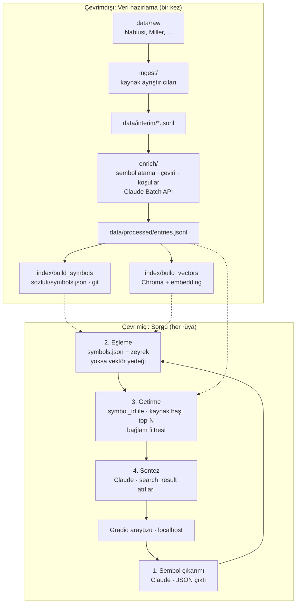

# 03 · Yazılım Mimarisi

> Durum: v0.2 · Tarih: 23 Ekim 2026 (iskelet kuruldu; klasör yapısı ve getirme çıktısı güncellendi)
> Kod düzeni, katman kuralları, modül imzaları ve veri ürünleri: [12-kod-yapisi-ve-sozlesmeler.md](12-kod-yapisi-ve-sozlesmeler.md)
> Teknoloji kararlarının gerekçeleri: [04-teknoloji-secimi.md](04-teknoloji-secimi.md)
> Çalışma ortamı (bilgisayar, `data/`, GitHub): [11-calisma-ortami.md](11-calisma-ortami.md)

## 1. Temel tasarım ilkeleri

1. **Önce sözlük, sonra vektör.** Rüya tabiri bir "belgede arama" problemi değil, bir "sözlükte sembol bulma" problemi. Kesin eşleme (sembol kimliği) birincil yol. Vektör arama yalnızca eşleşmeyen semboller için yedek.
2. **Her adım ayrı ve gözlemlenebilir.** Boru hattı dört saf adımdan oluşuyor. Her adımın girdisi ve çıktısı bir veri sınıfı. Hata ayıklama ekranı her adımın çıktısını gösterir.
3. **LLM yalnızca gerektiği yerde.** Ayrıştırma, eşleme ve getirme deterministik kod. LLM üç işte kullanılıyor: sembol çıkarma, sentez ve (çevrimdışı) zenginleştirme.
4. **Çevrimdışı ve çevrimiçi iş ayrı.** Veri hazırlama (çeviri, koşul ayrıştırma) bir kez ve toplu yapılır. Sorgu anındaki iş hafif tutulur.
5. **Kaynak her yerde taşınır.** Her kayıt, `kaynak`, `lisans` ve `konum` bilgisini boru hattının sonuna kadar götürür.
6. **Framework yok.** Düz Python ve az sayıda kütüphane kullanılır. Amaç her katmanı görerek öğrenmek.

## 2. Sistem görünümü



## 3. Sorgu boru hattı: adım adım

### Adım 1 · Sembol çıkarımı (`pipeline/extract.py`)

- **Girdi:** `RuyaGirdisi(metin: str, baglam: Baglam | None)`
- **Çıktı:** `CikarimSonucu(semboller: list[Sembol], ruya_turu_ipucu: str | None)`
  - `Sembol(yalin, nitelikler, eylem, duygu, olumsuz: bool, ham_ifade)`
- **Nasıl:** Claude çağrısı, yapılandırılmış çıktıyla (`output_config.format` ve JSON şeması). Düşük `effort` kullanılır, çünkü bu basit bir çıkarım işi.
- **Kurallar:** Semboller yalın hâlde ve küçük harfle döner. Olumsuz semboller `olumsuz=true` olarak işaretlenir ve sonraki adımlara geçmez.
- **Neden ayrı çağrı:** Claude API'de atıf (citations) özelliği ile yapılandırılmış çıktı aynı istekte kullanılamıyor (400 hatası). Bu yüzden çıkarım ve sentez iki ayrı çağrı.

### Adım 2 · Eşleme (`pipeline/map.py`)

- **Girdi:** `list[Sembol]`
- **Çıktı:** `list[Eslesme(sembol, symbol_id | None, yontem, guven)]`
- **Sıra:**
  1. Normalleştirme: Türkçeye uygun küçük harfe çevirme (I→ı, İ→i) ve boşluk ile noktalama temizliği.
  2. `symbols.json` içinde doğrudan arama: ad ya da varyant eşleşmesi.
  3. Bulunamazsa zeyrek ile kök bulup yeniden arama.
  4. Yine bulunamazsa vektör yedeği (Aşama 2): en yakın 3 sembolün ad ve tanım vektörlerinden en iyisi seçilir. Benzerlik eşiğin altındaysa `symbol_id=None` döner.
- `yontem` alanı şu değerlerden birini alır: `"birebir" | "kok" | "vektor" | "yok"`. Hata ayıklama ekranında gösterilir.

### Adım 3 · Getirme (`pipeline/retrieve.py`)

- **Girdi:** `list[Eslesme]`, `Baglam` ve seçilen gelenekler
- **Çıktı:** `dict[symbol_id, list[Aday]]`. `Aday` maddeyi, sıralama skorunu ve skorun gerekçelerini taşır; hata ayıklama sekmesi bunları gösterir (İG-42).
- **Nasıl:** `symbol_id` ile doğrudan filtreleme yapılır (Chroma `where` ya da bellekteki indeks). Her kaynaktan en fazla N madde alınır (varsayılan N=2).
- **Sıralama:**
  1. Nitelik eşleşmesi. Örneğin "siyah yılan" için içinde "siyah" geçen madde öne çıkar. Karşılaştırma `metin_tr` üzerinde, normalleştirilmiş ve köke indirilmiş kelimelerle yapılır. Bu yüzden çevirinin kelime seçimine bağlıdır: çeviri "kara yılan" demişse eşleşme kaçar. [terimler.md](terimler.md) sık nitelikler için tek karşılık belirleyerek bunu azaltır. Asıl çözüm Aşama 3'te yapılandırılmış `kosullar` alanıdır (`{"renk": "siyah"}`).
  2. Bağlam koşulu eşleşmesi (Aşama 3).
  3. Başlıklı madde, alt paragraftan önce gelir.
- **Aşama 2 eki:** Bir sembolün maddesi N'den fazlaysa, rüya cümlesine göre bge-reranker ile yeniden sıralama yapılır.

### Adım 4 · Sentez (`pipeline/synthesize.py`)

- **Girdi:** `CikarimSonucu`, getirilen maddeler, `Baglam`
- **Çıktı:** `Yorum(bolumler, atiflar, uyari)`
- **Nasıl:** Her madde bir `search_result` içerik bloğu olarak verilir:
  - `source` = `entry_id`
  - `title` = "Nablusi · حية (yılan)"
  - `content` = Türkçe çeviri ve asıl metin
  - `citations: {enabled: true}` ayarı açık

  Model her iddia için yapılandırılmış atıf döndürür. Var olmayan bir kaynağa atıf yapması API düzeyinde engellenir.
- **Sistem talimatı:** Kurallar [05-yorum-yontemi.md](05-yorum-yontemi.md) ve [07-etik-ve-hukuk.md](07-etik-ve-hukuk.md) belgelerinden gelir. Talimat metni `prompts/sentez_v1.md` dosyasında sürümlü tutulur. Talimat değiştiğinde değerlendirme yeniden çalıştırılır.
- **Çıktı yapısı:** Her sembol için "Kaynakların söyledikleri", ardından "Uzlaşılan noktalar", "Ayrışan noktalar" ve "Kaynaklarda bulunmayanlar". En sonda uyarı metni.

### Orkestrasyon (`pipeline/run.py`)

```
def yorumla(girdi: RuyaGirdisi, bag: Bagimliliklar) -> SorguKaydi:
    cikarim, kullanim = extract(girdi, bag.istemci)
    eslesmeler        = map_symbols(cikarim.gecerli_semboller[:8], bag.varyantlar, bag.vektor)
    getirilenler      = retrieve(eslesmeler, bag.depo, girdi.baglam, girdi.gelenekler, n)
    yorum, kullanim   = synthesize(cikarim, eslesmeler, getirilenler, girdi.baglam, bag.istemci)
    return SorguKaydi(...)   # her adımın çıktısı + AdimOlcumu (süre, token, maliyet, talimat)
```

`SorguKaydi` her adımın çıktısını, süresini, token sayısını ve maliyetini taşır. Arayüz ve değerlendirme betiği aynı nesneyi kullanır. `Bagimliliklar` boru hattının dış dünyaya (API, depo, sözlük) açılan tek kapısıdır; testlerde sahteleri verilir (bkz. [12](12-kod-yapisi-ve-sozlesmeler.md), bölüm 4). Orkestrasyon `src/ruya/pipeline/run.py` içinde hazır ve testli.

## 4. Klasör yapısı

```
C:\ruya-tabirnamesi\
├── README.md
├── CLAUDE.md                 # proje kuralları
├── pyproject.toml            # bağımlılıklar (temel + [indeks] [arayuz] [hepsi] ekleri), ruff, pytest
├── uv.lock                   # bilgisayardaki ortamın kilit dosyası
├── .gitattributes            # nbstripout filtresi
├── .gitignore                # data/, .env, .cache/, logs/ (önlem)
├── docs/                     # 00–12, KAYNAKLAR, terimler, kurallar, olcumler, arastirma/, deneyler/
├── notebooks/                # ince notebook'lar: deneyler ve inceleme (bkz. notebooks/README.md)
│   ├── _kurulum.py           # ilk hücrenin çağırdığı kurulum: anahtar kontrolü, autoreload
│   ├── 00_ortam_kontrolu.ipynb … 06_degerlendirme.ipynb
│   └── deneyler/
├── prompts/                  # sürümlü sistem talimatları: <is>_v<n>.md (bkz. prompts/README.md)
├── sozluk/
│   └── symbols.json          # elle onaylanan kanonik sembol indeksi (veri değil, sözlük → git'te)
├── scripts/
│   └── download_sources.py   # ham kaynakları data/raw/ altına indirir, SHA256 kaydeder
├── src/ruya/
│   ├── config.py             # veri yolları (data/), model adları ve fiyatlar
│   ├── hatalar.py            # ApiAnahtariYok, ModelReddetti, SozlukHatasi…
│   ├── schemas.py            # Pydantic veri sınıfları: Madde, Sembol, Eslesme, Aday, Yorum, SorguKaydi…
│   ├── etik.py               # uyarı metni, güvenlik notu, yasak ifadeler
│   ├── dosya.py              # JSONL okuma/yazma
│   ├── kayit.py              # sorgu logu (rüya metni olmadan), isteğe bağlı geçmiş
│   ├── text/turkce.py        # Türkçe küçük harf, normalleştirme, zeyrek sarmalayıcı
│   ├── llm/                  # client.py (önbellek, maliyet, hata), talimatlar.py
│   ├── ingest/               # kaynaklar.py (künye ve lisans), nablusi.py, miller.py, ibn_sirin.py, freud.py
│   ├── enrich/               # assign_symbols.py, translate.py, conditions.py
│   ├── index/                # build_symbols.py, store.py, build_vectors.py, yedek.py
│   ├── pipeline/             # extract.py, map.py, retrieve.py, synthesize.py, run.py
│   └── degerlendirme/        # metrikler.py, calistir.py
├── app/
│   └── gradio_app.py         # arayüz; notebooks/05_arayuz.ipynb içinden açılır
├── eval/
│   ├── dataset/              # ruyalar_v1.jsonl (test seti; kendi rüyaların → repo özel kalmalı)
│   └── run_eval.py           # ince CLI; mantık ruya.degerlendirme'de
└── tests/                    # pytest: birim, mimari, kontrat (-m veri) testleri + fixtures/
```

Her modülün sorumluluğu, imzası ve hangi haftada yazılacağı: [12](12-kod-yapisi-ve-sozlesmeler.md), bölüm 2.

Veri repodaki `data/` klasöründe durur ve git'e girmez (bkz. [11](11-calisma-ortami.md), bölüm 3). Ölçüm raporları da `data/raporlar/` altında tutulur. Her kilometre taşında özet tablo `docs/olcumler.md` dosyasına işlenip commit edilir.

## 5. Kesişen konular

### 5.1 Yapılandırma

- `config.py` ayarları ortam değişkenlerinden okur (pydantic-settings).
- **Veri yolu:** Bütün veri yolları `<repo>/data` altındadır; `RUYA_DATA_DIR` ile değiştirilebilir. Kod bu klasörün dışına veri yazmaz (`tests/test_config.py`).
- **Gizli bilgiler:** API anahtarı kullanıcı ortam değişkeninde durur ([10](10-kurulum-rehberi.md), adım 1). Hiçbir dosyaya (`.env` dahil) yazılmaz.
- **Model adları tek bir yerde:** `MODEL_CIKARIM`, `MODEL_SENTEZ`, `MODEL_CEVIRI`. Model değiştirmek tek satırlık bir iş.
- Hugging Face modelleri gerekirse `<repo>/.cache/hf` altına iner (git'e girmez).

### 5.2 LLM istemcisi (`llm/client.py`)

- **Tek sarmalayıcı:** Bütün Claude çağrıları buradan geçer.
- **Disk önbelleği (`data/cache/llm/`):** Her istek için ayrı bir JSON dosyası tutulur. Anahtar, istek içeriğinin özetidir (hash). Tek dosyalı bir veritabanı kullanılmaz; dosyalar tek tek okunup silinebilir. Geliştirme sırasında aynı istek ikinci kez ücret ödetmez. `RUYA_LLM_CACHE=off` ile tamamen kapatılabilir.
- **Rüya içeren istekler varsayılan olarak önbelleğe yazılmaz.** Çıkarım ve sentez isteklerinde rüya metni, yanıtlarında da rüyanın parçaları (`ham_ifade`) ve yorumu bulunur. Bunlar önbelleğe yazılsaydı rüya geçmişi kapalıyken bile rüyalar diskte birikirdi (İOG-03). Bu yüzden:
  - `LLMIstemcisi.mesaj(istek, ruya_icerir=True)` ile çağrılan istekler diske yalnızca `RUYA_SORGU_ONBELLEGI=on` iken yazılır ve oradan okunur. Varsayılan değer kapalıdır.
  - Değerlendirme bu ayarı açar. Test setindeki rüyalar zaten repoda olduğu için yeni bir şey açığa çıkmaz ve aynı ölçüm ikinci kez ücret ödetmez.
  - Çevrimdışı işler (çeviri, sembol atama, koşul ayrıştırma) rüya içermez ve yalnızca `RUYA_LLM_CACHE` ayarına uyar.
- **Ölçüm:** Her yanıttaki `usage` bilgisi okunur ve tutar hesaplanıp `SorguKaydi`'ya yazılır.
- **Hata yönetimi:** Hata sınıfları ayrı ayrı yakalanır. 429 ve 5xx hataları SDK'nın yeniden deneme mekanizmasıyla tekrarlanır. 400 hatası tekrarlanmaz, loglanır ve kullanıcıya anlaşılır bir mesaj gösterilir. Yanıtta `stop_reason` her zaman kontrol edilir; değer `refusal` ise kullanıcıya bilgi verilir.
- **Prompt önbelleği:** Sabit sistem talimatı önbelleklenir. Bir oturumda arka arkaya yapılan sorgularda maliyeti düşürür. Önbelleğin çalıştığı `usage.cache_read_input_tokens` ile doğrulanır.

### 5.3 Loglama ve gizlilik

- **Log içeriği:** `data/logs/sorgular.jsonl` dosyasına zaman, adım süreleri, token sayıları, maliyet, sembol kimlikleri ve eşleme yöntemleri yazılır. **Rüya metni yazılmaz.**
- **Rüya geçmişi:** Rüyaları saklamak isteğe bağlı bir ayar (`RUYA_GECMIS=on`). Açıksa rüyalar `data/gecmis/` altında tutulur. Rüyaların diske yazıldığı başka tek yer, varsayılanı kapalı olan sorgu önbelleğidir (bölüm 5.2).
- Loglar ve veri `data/` altında durur, git'e girmez. Notebook çıktıları `nbstripout` ile temizlenir.

### 5.4 Hata durumları

| Durum | Davranış |
|---|---|
| Hiç sembol çıkmadı | "Rüyanda tabir edilecek bir sembol bulamadım" mesajı ve çıkarım çıktısı hata ayıklama sekmesinde gösterilir. |
| Sembol var, maddesi yok | Yanıtta o sembol "Kaynaklarda bulunamayanlar" bölümünde listelenir. Model tahmin yürütmez. |
| Çok fazla sembol (>8) | En belirgin 8 sembol işlenir, diğerleri listelenir. Maliyet ve süre böylece sınırlı kalır. |
| API anahtarı yok veya geçersiz | Uygulama açılışta kontrol edip net bir mesaj verir. |
| `refusal` stop reason | "Bu rüya yorumlanamadı" mesajı gösterilir, olay loglanır. |

### 5.5 Test stratejisi

- **Birim testleri (pytest):**
  - Ayrıştırıcılar: örnek satırlardan beklenen kayıtların çıktığı.
  - Türkçe normalleştirme: I/İ dönüşümü ve ekli biçimler.
  - Eşleme: varyanttan doğru `symbol_id`'ye ulaşılması.
  - Getirme: kaynak başına N sınırının uygulanması.
- **Mimari testleri (`tests/test_mimari.py`):** katmanlar arası içe aktarma kuralı, model adlarının yalnızca `config.py`'de olması, ağır paketlerin tembel yüklenmesi; ayrıca notebook çıktılarının temizliği ve sözlüğün şemaya uyması.
- **Kontrat testleri (`tests/test_kontrat_veri.py`, `-m veri`):** `entries.jsonl` dosyasındaki her kayıt şemaya uyuyor, `lisans` alanı dolu, `entry_id` benzersiz. Veri henüz yoksa kendiliğinden atlanır.
- **Boru hattı testleri:** `eval/run_eval.py` ile test seti üzerinde ölçüm yapılır (bkz. [06-degerlendirme.md](06-degerlendirme.md)). Bu testler LLM çağırdığı için ücretli. Elle çalıştırılır, CI'da çalışmaz.
- **Nerede çalışır:** Birim testleri veri gerektirmez. `tests/fixtures/` altındaki birkaç satırlık örnekleri kullanır. Bu yüzden veri indirilmeden de çalışır.

## 6. Bilerek yapılmayanlar (ve nedenleri)

| Yapılmayan | Neden | Ne zaman yeniden düşünülür |
|---|---|---|
| LangChain / LlamaIndex | Öğrenmeyi gizler, `search_result` atıflarını sarmalar | Gerek yok |
| Ayrı bir vektör veritabanı sunucusu (Qdrant vb.) | ~10 bin kayıt için gereksiz | Korpus 100 bini geçerse |
| Ajan (agent) yapısı | Adımlar baştan belli. Ajan maliyet ve belirsizlik ekler. | Gerek yok |
| Kullanıcı hesabı ve sunucu | Proje kişisel | Proje paylaşılırsa (o zaman KVKK ve lisanslar yeniden ele alınır) |
| Hibrit BM25 araması | Sembol kimliğiyle eşleme bu ihtiyacı büyük ölçüde karşılıyor | Aşama 3'te ölçüm gerekli gösterirse |
