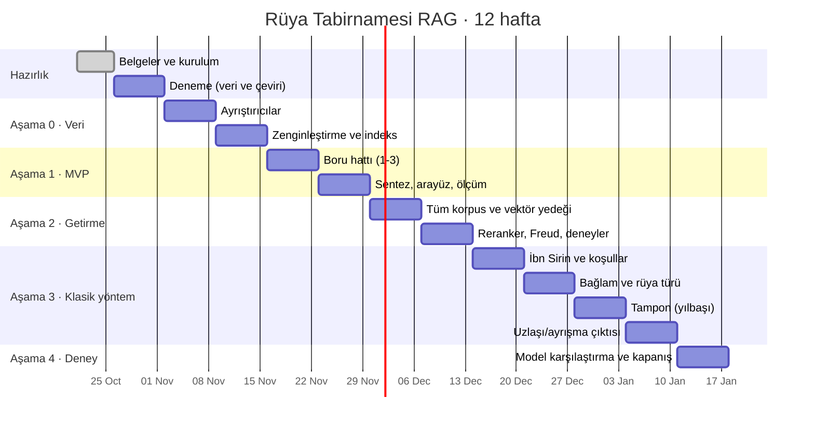

# 08 · Yol Haritası ve Takvim

> Durum: Taslak v0.1 · Tarih: 21 Ekim 2026
> **Varsayım:** Haftada 8–10 saat çalışma. Daha az ya da daha çok vakit ayırabileceksen takvim yeniden ölçeklenir (bkz. [09-riskler-ve-acik-sorular.md](09-riskler-ve-acik-sorular.md), S1).
> **Takvim dosyası:** [`takvim.ics`](takvim.ics). Google Takvim'e ya da Outlook'a içe aktarılabilir. Haftalık hedefleri ve kilometre taşlarını içerir.

## Genel bakış

## Kilometre taşları

| Tarih | Taş | "Bitti" ölçütü |
|---|---|---|
| **1 Kasım 2026** | K0 · Deneme tamam | `docs/deneyler/01-veri-ve-ceviri.md` yazılmış. Nablusi'nin ayrıştırılabilirliği ve çeviri kalitesi hakkında net bir karar alınmış. |
| **15 Kasım 2026** | K1 · Veri hazır | `entries.jsonl` dosyasında Nablusi ve Miller var. 50 sembollük `symbols.json` gözden geçirilmiş. 20 rüyalık test seti yazılmış. |
| **29 Kasım 2026** | K2 · `v0.1-mvp` | Uçtan uca çalışıyor. İlk ölçüm raporu var. [01-gereksinimler.md](01-gereksinimler.md)'deki MVP kabul ölçütleri sağlanmış. |
| **13 Aralık 2026** | K3 · `v0.2` | Vektör yedeği ve reranker çalışıyor. D1–D3 deneyleri raporlanmış. |
| **10 Ocak 2027** | K4 · `v0.3` | Koşullu yorum, rüya türü ve uzlaşı/ayrışma çıktısı tamam. 40–50 rüyalık test setinde ölçülmüş. |
| **17 Ocak 2027** | K5 · `v1.0` | Model karşılaştırması bitti, README ve demo hazır. Proje tamam. |

## Hafta hafta plan

### Hafta 0 · 21–25 Ekim · Belgeler ve kurulum ✅ (büyük kısmı bitti)

- [x] Proje fikri ve araştırma
- [x] Proje belgeleri (00–11)
- [x] Mimari iskelet (23 Ekim): `src/ruya/` paketi, veri sözleşmeleri, modül arayüzleri, mimari testleri; eksik belgeler (12, KAYNAKLAR, terimler, şablonlar)
- [ ] Belgeleri oku, açık soruları cevapla ([09](09-riskler-ve-acik-sorular.md))
- [x] API anahtarı: `EVREN_LLM_API_KEY` kullanıcı ortam değişkeninde (31 Ekim; Claude API yerine EVREN, TK-03); GitHub özel repo ([10-kurulum-rehberi.md](10-kurulum-rehberi.md))
- [x] ~~Google Drive klasörü ve Colab Secrets~~ (31 Ekim: bilgisayarda çalışmaya geçildi; API anahtarı kullanıcı ortam değişkeninde)
- [x] İlk push

### Hafta 1 · 26 Ekim – 1 Kasım · Deneme (atılabilir kod)

**Amaç:** Projenin iki büyük bilinmeyenini cevaplamak. Hepsi bilgisayarda, `notebooks/deneyler/01_veri_ve_ceviri.ipynb` içinde yapılır. Veri `data/` altına iner.

- [ ] `config.py` ve `llm/client.py`: EVREN geçidi, `deepseek-v4.1-flash`, disk önbelleği, yeniden deneme, `toplu` (31 Ekim kararıyla Hafta 4'ten öne alındı; deneme bu istemciyi kullanır)
- [ ] `notebooks/_kurulum.py`: bilgisayara uyarla (anahtar kontrolü, autoreload); Colab sürümü 23 Ekim'de yazılmıştı
- [ ] `00_ortam_kontrolu.ipynb` ile Python sürümünü, API anahtarını ve `data/` yollarını kontrol et

- [x] `scripts/download_sources.py` ile dört kaynağı `data/raw/` altına indir; SHA256 değerleri `kaynaklar.py`'ye sabitlendi (31 Ekim).
- [ ] Deneme betiği: Nablusi'nin "ح" (ḥâ) babından 50 paragrafı ayrıştır. Başlıklı maddeleri ve alt paragrafları say.
- [ ] 10 Nablusi ve 10 Miller maddesini `deepseek-v4.1-flash` ile Türkçeye çevir. Çevirileri yan yana koyup oku ve 1–5 arası puan ver.
- [ ] 10 alt paragrafı "hangi sembole ait?" sorusuyla LLM'e sınıflandırt ve doğruluğu say.
- [ ] Gerçek token sayılarını ve istek sürelerini ölç; tüm korpusun çevirisinin günlük kotaya ve 1 Aralık'a kadar sürecek ücretsiz döneme sığıp sığmadığını hesapla.
- [ ] **Çıktı:** `docs/deneyler/01-veri-ve-ceviri.md`. Hipotez, sonuç ve karar.

**Karar noktası (K0):** Çeviri kalitesi 3/5'in altındaysa çeviri talimatı iyileştirilir ya da İngilizce ara katman denenir. Bu durumda 1 hafta kayma olur.

### Hafta 2 · 2–8 Kasım · Aşama 0: Ayrıştırıcılar

- [x] Repo iskeleti: `pyproject.toml`, `src/ruya/`, `tests/`, ruff ve pytest ayarları, `nbstripout` git filtresi (23 Ekim)
- [x] `config.py`: veri yolları (23 Ekim; 31 Ekim'de Colab/Drive yerine `data/`)
- [ ] `notebooks/01_kaynaklari_indir.ipynb` ve `02_ayristir.ipynb`
- [x] `schemas.py`: `Madde`, `SymbolKaydi` ve boru hattı veri sınıfları (23 Ekim)
- [x] `ingest/miller.py` ve birim testleri (2.256 madde)
- [x] `ingest/nablusi.py`: başlıklı maddeler, alt paragraflar, sayfa bilgisi, `~~`, `ms` ve `PageV` temizliği, birim testleri
- [x] `text/turkce.py`: Türkçe küçük harf ve normalleştirme, testleri
- [x] Kontrat testi: bütün kayıtlarda `lisans` dolu ve `entry_id` benzersiz (`tests/test_kontrat_veri.py`, veri gelince `-m veri`)

### Hafta 3 · 9–15 Kasım · Aşama 0: Zenginleştirme ve indeks

- [ ] 50 sembollük ilk liste: LLM önerecek, sen onaylayacaksın. `sozluk/symbols.json` dosyasına (git'te) Türkçe, Arapça ve İngilizce varyantlar eklenecek.
- [ ] `enrich/assign_symbols.py`: alt paragraflara sembol atama (yalnızca 50 sembolün babları)
- [x] Korpus çevirisi öne alındı ve bitti (2 Kasım; [02](02-veri-kaynaklari-ve-semasi.md), bölüm 5). `enrich/ceviri_birlestir.py` çıktıları maddelere işler.
- [ ] `docs/terimler.md`: taslak hazır (23 Ekim); Hafta 1 çevirileriyle büyüt, satırları kontrol et
- [ ] `docs/kurallar.md` (şablon hazır): TDV, Balaban ve Elbir & Uludüz okumalarından kendi cümlelerinle notlar
- [x] `eval/dataset/ruyalar_v1.jsonl`: 20 rüya ve beklenen semboller (2 Kasım; tamamı sentetik, EVREN üretti. Gözden geçirmen bekleniyor; maddeler sonra eklenecek)

### Hafta 4 · 16–22 Kasım · Aşama 1: Boru hattı (adım 1–3)

- [x] `pipeline/extract.py` ve `prompts/cikarim_v1.md`: JSON şemalı sembol çıkarımı
- [x] `pipeline/map.py`: birebir eşleme, zeyrek ile kök eşleme ve testleri
- [x] `pipeline/retrieve.py`: `symbol_id` ile getirme, kaynak başına N sınırı, nitelik sıralaması ve testleri
- [ ] Test setindeki `beklenen_maddeler` alanlarını doldur

### Hafta 5 · 23–29 Kasım · Aşama 1: Sentez, arayüz, ölçüm → **v0.1-mvp**

- [x] `pipeline/synthesize.py` ve `prompts/sentez_v1.md`: numaralı kaynaklar, JSON çıktısı ve `atiflari_dogrula`
- [x] `pipeline/run.py` ve `SorguKaydi`
- [x] `app/gradio_app.py` (2 Kasım; `05_arayuz.ipynb` yerine `scripts/arayuz_ac.py`): rüya kutusu, yanıt, tıklanabilir atıflar, hata ayıklama sekmesi, uyarı metni (`share` kapalı)
- [ ] `eval/run_eval.py`, `06_degerlendirme.ipynb`, ilk ölçüm raporu (`data/raporlar/`) ve `docs/olcumler.md`
- [ ] MVP kabul ölçütlerinin kontrolü, ardından `v0.1-mvp` etiketi

### Hafta 6 · 30 Kasım – 6 Aralık · Aşama 2: Tüm korpus ve vektör yedeği

- [ ] Nablusi ve Miller'ın tamamı için sembol atama ve çeviri (`toplu`, kota kontrolüyle). ⚠️ EVREN modelleri 1 Aralık 2026'ya kadar ücretsiz; bu iş Hafta 3'ün sonuna, ücretsiz döneme çekilmeli (R13, [09](09-riskler-ve-acik-sorular.md)).
- [ ] `symbols.json` dosyasını ~150 sembole genişlet
- [ ] `index/build_vectors.py` ve `04_indeks.ipynb`: Chroma ve embedding modeli; indeks `data/index/chroma` altında
- [ ] Eşlemeye vektör yedeğini ekle, eşik değerini test setiyle ayarla

### Hafta 7 · 7–13 Aralık · Aşama 2: Reranker, Freud, deneyler → **v0.2**

- [x] `ingest/freud.py`: paragraf bazlı, "yöntem" katmanı
- [ ] bge-reranker-v2-m3 entegrasyonu
- [ ] Deneyler D1 (embedding), D2 (reranker), D3 (N değeri) ve `docs/deneyler/` notları
- [ ] Gelenek seçimi arayüzü (İG-03), ardından `v0.2` etiketi

### Hafta 8 · 14–20 Aralık · Aşama 3: İbn Sirin ve koşullar

- [x] `ingest/ibn_sirin.py` ve "nispeti sahih değil" atıf notu
- [ ] `enrich/conditions.py`: koşul ayrıştırma (`kosullar`, `yontem`, `kapsam`). 20 maddeyi elle kontrol et.
- [ ] Bab ve HVDC kategorilerini `symbols.json` dosyasına ekle

### Hafta 9 · 21–27 Aralık · Aşama 3: Bağlam ve rüya türü

- [ ] Arayüze bağlam formu (İG-02)
- [ ] Getirmede bağlam koşulu eşleşmesi (İG-23)
- [ ] Çıkarımda rüya türü ipucu ve hassas içerik bayrağı (İG-14, güvenlik ağı)

### Hafta 10 · 28 Aralık – 3 Ocak · Tampon (yılbaşı)

- [ ] Geride kalan işler
- [ ] Test setini 40–50 rüyaya genişlet, özel testleri ekle

### Hafta 11 · 4–10 Ocak · Aşama 3: Uzlaşı/ayrışma çıktısı → **v0.3**

- [ ] `prompts/sentez_v2.md`: koşullu yorum, "Uzlaşılan / Ayrışan / Diğer vecihler" çıktısı ve yöntem açıklamaları
- [ ] Tam ölçüm ve v1 ile karşılaştırma, ardından `v0.3` etiketi

### Hafta 12 · 11–17 Ocak · Aşama 4: Deney ve kapanış → **v1.0**

- [ ] D4: EVREN'deki başka bir sohbet modeliyle karşılaştırma (sentez ve çıkarım)
- [ ] D5 (isteğe bağlı): yerel açık model (Gemma, Qwen)
- [ ] Son README: kurulum, mimari özeti, ölçüm tablosu, öğrendiklerim
- [ ] `v1.0` etiketi

## İsteğe bağlı devam (Ocak sonrası)

- *Zhougong Jiemeng* ve Talmud kaynaklarının eklenmesi
- Hibrit BM25 araması
- Sembol istatistikleri: "rüyalarında en sık görülen semboller"
- Bir blog yazısı ya da sunum: "Türkçe rüya tabiri için RAG: öğrendiklerim"
