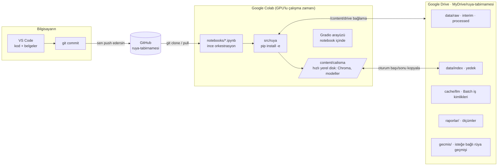

# 11 · Çalışma Ortamı: Colab ve Google Drive

> Durum: Taslak v0.1 · Tarih: 22 Ekim 2026
> Karar: Ağır işler ve veri bilgisayarda değil, **Google Colab** ve **Google Drive** üzerinde. Bilgisayarda yalnızca kod yazılır.

## 1. Önce bir netleştirme: bu projede "eğitim" yok

RAG projelerinde model **eğitilmez**. Hazır modeller kullanılır, onlara doğru bilgi verilir. Ekran kartı (GPU) gerektiren işler şunlar:

| İş | Ne zaman | GPU gerekli mi? | Colab'de süre (tahmini, doğrulanmadı) |
|---|---|---|---|
| Embedding hesaplama (~10 bin madde, e5-large) | Aşama 2 | Şart değil ama çok hızlandırır | T4 GPU ile birkaç dakika (CPU'da 30 dakikadan fazla) |
| Reranker (bge-reranker-v2-m3) | Aşama 2 | Hızlandırır | Sorgu başına saniyenin altında |
| Yerel LLM deneyi (Gemma, Qwen) | Aşama 4 | **Şart** | T4'te 4-bit sıkıştırılmış ~12B model sığar |

Geri kalan her şey GPU istemez: ayrıştırma, Claude API çağrıları, sembol eşleme, arayüz. Bunlar da tutarlılık için Colab'de çalışacak.

İleride bir modeli gerçekten ince ayarlamak (fine-tuning) istersen bu ortam ona da hazır. Ama planda yok.

## 2. Üç yer, üç görev



| Yer | Ne durur | Ne yapılır |
|---|---|---|
| **Bilgisayar** | Yalnızca kod ve belgeler (git reposu). Veri seti **yok**. | Kod yazma, belge düzenleme, commit. İsteğe bağlı olarak verisiz hafif birim testleri. |
| **GitHub** | Kod, belgeler, notebook'lar (çıktıları temizlenmiş) | Push'u sen yaparsın. Colab buradan çeker. |
| **Google Colab** | Geçici: her oturumda sıfırlanır | Bütün çalıştırma: indirme, ayrıştırma, zenginleştirme, indeks, arayüz, değerlendirme |
| **Google Drive** | Kalıcı veri, önbellekler, ölçüm raporları | Colab oturumları arasında hafıza görevi görür |

## 3. Drive klasör yapısı

```
MyDrive/ruya-tabirnamesi/
├── data/
│   ├── raw/          # indirilen kaynaklar + SHA256 kayıtları (Colab doğrudan buraya indirir)
│   ├── interim/      # ayrıştırılmış jsonl
│   ├── processed/    # entries.jsonl
│   └── index/        # chroma.zip (yedek); sembol sözlüğü git'te: sozluk/symbols.json
├── cache/
│   ├── llm/          # LLM yanıt önbelleği: istek başına bir JSON dosyası
│   └── batch/        # gönderilmiş Batch işlerinin kimlikleri ve durumları
├── raporlar/         # değerlendirme raporları (tarihli)
├── gecmis/           # isteğe bağlı rüya geçmişi (RUYA_GECMIS=on ise)
└── logs/             # sorgu logları (rüya metni olmadan)
```

## 4. Drive ile çalışırken uyulacak kurallar

Drive, Colab'e bir dosya sistemi gibi bağlanır (`/content/drive`). Ancak bu bağlantı yavaştır ve SQLite gibi kilit kullanan veritabanlarıyla sorun çıkarabilir (doğrulanmadı, yaygın bir deneyim). Bu yüzden:

1. **Chroma Drive'da çalıştırılmaz.**
   - Oturum başında `data/index/chroma.zip` dosyası `/content/calisma/chroma/` klasörüne açılır.
   - İndeks yeniden kurulduysa oturum sonunda tekrar zip'lenip Drive'a kopyalanır.
2. **LLM önbelleği Drive'da durur.** Her istek için ayrı bir JSON dosyası tutulur, anahtar isteğin özetidir (hash). Tek dosyalı bir veritabanı kullanılmaz. Böylece önbellek oturumlar arasında korunur ve aynı istek için iki kez ödeme yapılmaz. Rüya içeren sorgu istekleri varsayılan olarak bu önbelleğe girmez ([03](03-mimari.md), bölüm 5.2).
3. **Hugging Face modelleri Colab'in yerel diskine iner** (`HF_HOME=/content/calisma/hf`). Colab'in indirme hızı yüksek. Drive'da 2 GB'lık model saklamaya gerek yok.
4. **Batch API işleri oturumdan bağımsızdır.** İş gönderilince kimliği `cache/batch/` klasörüne yazılır. Sonuçlar ertesi gün başka bir oturumda alınabilir. Colab'in zaman aşımları bu yüzden sorun olmaz.
5. **Büyük dosyalar Drive'a parça parça yazılmaz.** Önce `/content` altına yazılır, iş bitince tek seferde kopyalanır.

## 5. Kod Colab'e nasıl gelir?

- **Notebook'lar ince tutulur.** Mantık `src/ruya/` paketinde durur. Notebook yalnızca sırayla fonksiyon çağırır. Böylece kod test edilebilir, sürümlenebilir ve bilgisayarda da okunabilir kalır.
- **Her notebook'un ilk hücresi aynıdır.** Hücre repo yoksa onu klonlar (repo özelse `GITHUB_TOKEN` ile), sonra `%run` ile `notebooks/_kurulum.py`'yi çalıştırır. Hücrenin metni: [`notebooks/README.md`](../notebooks/README.md). `_kurulum.py` sırasıyla:
  1. Drive'ı bağlar: `drive.mount('/content/drive')`.
  2. `ANTHROPIC_API_KEY`'i `google.colab.userdata` içinden ortam değişkenine aktarır. Yazdırmaz, dosyaya yazmaz.
  3. Repoyu günceller: `git pull`. Token remote adresinde tutulmaz, yalnızca istek başlığında kullanılır.
  4. Paketi kurar: `pip install -e /content/ruya-tabirnamesi`. Ağır paketler gerekiyorsa ilk hücrede `RUYA_EKLER=colab` ayarlanır (Chroma, sentence-transformers, Gradio).
  5. Ortam değişkenlerini ayarlar: `RUYA_DATA_DIR=/content/drive/MyDrive/ruya-tabirnamesi`, `RUYA_WORK_DIR=/content/calisma`, `HF_HOME`. Drive alt klasörlerini açar ve `autoreload`'u etkinleştirir.
- **`config.py` ortamı kendisi algılar.** Colab'de çalıştığını `"google.colab" in sys.modules` ile anlar ve yolları buna göre seçer. Bilgisayarda çalışırken veri yolu yoktur; yalnızca verisiz testler çalışır.
- **Notebook planı:**

| Notebook | İş | Aşama |
|---|---|---|
| `00_ortam_kontrolu.ipynb` | Python, GPU, Drive, Secrets kontrolü; birim testleri | Hazırlık |
| `01_kaynaklari_indir.ipynb` | Ham kaynakları Drive'a indirir | 0 |
| `02_ayristir.ipynb` | `interim/*.jsonl` üretir, istatistik gösterir | 0 |
| `03_zenginlestir.ipynb` | Sembol atama ve çeviri Batch işlerini gönderir, sonuçları toplar | 0, 2, 3 |
| `04_indeks.ipynb` | Chroma indeksini kurar (GPU), Drive'a zip olarak yedekler | 2 |
| `05_arayuz.ipynb` | Gradio arayüzünü notebook içinde açar | 1+ |
| `06_degerlendirme.ipynb` | Test setini çalıştırır, raporu Drive'a yazar | 1+ |
| `deneyler/*.ipynb` | Hafta 1 denemesi, D1–D5 deneyleri | 1, 2, 4 |

- **Notebook çıktıları commit'ten önce temizlenir.** Çıktılarda rüya metni ya da API yanıtı kalabilir. Bunun için `nbstripout` bir git filtresi olarak kurulur (`.gitattributes`; her klonda bir kez `uv run nbstripout --install`). `tests/test_notebooklar.py` çıktısı kalmış notebook'u ayrıca yakalar. Colab'in "GitHub'a kopya kaydet" özelliği bu filtreyi atladığı için kullanılmaz.

## 6. Arayüz: Streamlit yerine Gradio

Colab'de Streamlit çalıştırmak için ayrıca bir tünel servisi gerekiyor. Gradio ise notebook hücresinin içinde doğrudan açılabiliyor. Bu yüzden arayüz **Gradio** oldu (bkz. TK-09).

**Önemli:** `share=True` kullanılmaz. Bu ayar herkese açık bir link üretir. Linki bulan herkes senin API anahtarınla, senin hesabına sorgu çalıştırabilir. Arayüz yalnızca notebook içinde gösterilir.

## 7. Colab'in sınırları

Ücretsiz katman için genel bilgiler. Kesin rakamlar Google tarafından yayımlanmıyor ve değişebiliyor.

- **Oturum sınırları:** Boşta kalan oturum yaklaşık 90 dakika sonra kapanabiliyor. En uzun oturum süresi yaklaşık 12 saat.
- **GPU erişimi:** GPU her zaman garanti değil, kullanım yoğunluğuna göre kısıtlanabiliyor. Plan buna göre yapıldı: GPU yalnızca Aşama 2'deki indeks kurulumunda ve Aşama 4 deneyinde gerekiyor. Diğer bütün işler CPU çalışma zamanında yapılabilir.
- **Kalıcılık:** Oturum kapanınca `/content` silinir. Kalıcı olması gereken her şey Drive'a yazılır (bkz. bölüm 4).
- **Colab Pro:** Bu proje için gerekli değil. Aşama 4'te yerel LLM deneyi ücretsiz GPU'ya sığmazsa yeniden değerlendirilir.
