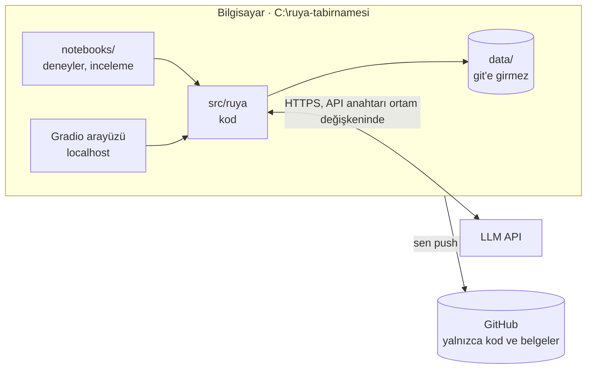

# 11 · Çalışma Ortamı: Bilgisayar

> Durum: v0.2 · Tarih: 31 Ekim 2026
> Karar: Kod yazma, çalıştırma ve veri **bilgisayarda**. Google Colab ve Google Drive kullanılmaz.
> Önceki sürüm (v0.1, 22 Ekim 2026) Colab + Drive düzenini anlatıyordu; gerekçesi bölüm 6'da.

## 1. Bu projede "eğitim" yok

RAG projelerinde model **eğitilmez**. Hazır bir model kullanılır, ona her soruda ilgili kaynak maddeleri verilir. Modelin kendisi bir API'nin arkasında, sağlayıcının sunucularında çalışır. Bilgisayara düşen işler hafif:

| İş | Nerede hesaplanır | Bilgisayara yükü |
|---|---|---|
| Kaynakları indirme, ayrıştırma | Bilgisayar | Saniyeler, birkaç MB |
| Sembol atama, çeviri, koşul çıkarma | LLM API | Yalnızca istek gönderip yanıt yazar; uzun sürer ama işlemciyi yormaz |
| Sembol eşleme, getirme | Bilgisayar | Bellekte tablo araması |
| Yorum yazma | LLM API | İstek başına birkaç saniye bekleme |
| Embedding (Aşama 2) | API'deki embedding modeli ya da yerel model | API'de yük yok; yerelde CPU ile yavaş olabilir (Aşama 2'de karar verilir) |

GPU gerektiren bir iş planda yok.

## 2. İki yer, iki görev



| Yer | Ne durur | Ne yapılır |
|---|---|---|
| **Bilgisayar** | Kod, belgeler ve `data/` altındaki bütün veri | Kod yazma, testler, indirme, ayrıştırma, zenginleştirme işlerini başlatma, arayüz, değerlendirme |
| **GitHub** | Kod, belgeler, çıktısı temizlenmiş notebook'lar | Yedek ve sürüm geçmişi. Veri buraya **girmez**. |

## 3. `data/` klasör yapısı

Bütün yollar `src/ruya/config.py` içindeki `Ayarlar` sınıfından gelir. Varsayılan kök `<repo>/data`; `RUYA_DATA_DIR` ortam değişkeniyle değiştirilebilir.

```
data/
├── raw/          # indirilen kaynaklar + KAYNAK_OZETLERI.json (SHA256)
├── interim/      # ayrıştırılmış jsonl
├── processed/    # entries.jsonl
├── index/        # chroma/ (Aşama 2); sembol sözlüğü git'te: sozluk/symbols.json
├── cache/
│   └── llm/      # LLM yanıt önbelleği: istek başına bir JSON dosyası
├── raporlar/     # değerlendirme raporları (tarihli)
├── gecmis/       # isteğe bağlı rüya geçmişi (RUYA_GECMIS=on ise)
└── logs/         # sorgu logları (rüya metni olmadan)
```

Toplam boyut küçük: dört ham kaynak birlikte 10 MB'ın altında. İşlenmiş maddeler ve çeviriler onlarca MB'a, Aşama 2'deki vektör indeksi birkaç yüz MB'a çıkabilir.

Hugging Face modelleri gerekirse `<repo>/.cache/hf` altına iner (git'e girmez).

## 4. Kurallar

1. **Veri git'e girmez.** `data/` `.gitignore`'da. Nedenleri: lisans (NC/SA kaynaklar yeniden dağıtılmaz) ve gizlilik (önbellek, log ve geçmişte rüya metni olabilir).
2. **Kod `data/` dışına veri yazmaz.** `tests/test_config.py` bütün veri yollarının `data_dir` altında olduğunu denetler.
3. **API anahtarı yalnızca ortam değişkeninde durur.** Windows'ta kullanıcı ortam değişkeni olarak bir kez tanımlanır ([10](10-kurulum-rehberi.md)). `.env` dahil hiçbir dosyaya yazılmaz, notebook'ta yazdırılmaz.
4. **LLM önbelleği diskte durur.** Her istek için ayrı bir JSON dosyası tutulur, anahtar isteğin özetidir (hash). Aynı istek için iki kez beklenmez ya da ödeme yapılmaz. Rüya içeren sorgu istekleri varsayılan olarak önbelleğe girmez ([03](03-mimari.md), bölüm 5.2).
5. **Uzun işler kaldığı yerden devam eder.** Zenginleştirme gibi saatler sürebilecek işler sonuçları madde madde diske yazar; süreç kesilirse yeniden başlatıldığında önbellekteki istekler tekrar gönderilmez.
6. **Büyük dosyalar yarım kalmaz.** Önce hedefin yanına geçici bir dosya yazılır, iş bitince tek adımda yerine taşınır (`ruya.dosya`).

## 5. Çalıştırma

- **Kurulum:** `uv sync` (temel paketler). Arayüz ve indeks için ağır paketler isteğe bağlı: `uv sync --extra hepsi`.
- **Testler:** `uv run pytest`. Birim testleri verisizdir. Kontrat testleri (`-m veri`) `data/` altındaki gerçek veriyi denetler; veri yoksa kendiliğinden atlanır.
- **İşler betik olarak çalışır:** örneğin `uv run python scripts/download_sources.py`. Hafta hafta eklenen ayrıştırma, zenginleştirme ve değerlendirme komutları da aynı biçimde çalışır ([08](08-yol-haritasi-takvim.md)).
- **Notebook'lar ince tutulur.** VS Code'da `.venv` çekirdeğiyle açılır. Mantık `src/ruya/` paketinde durur; notebook fonksiyon çağırır, sonuçları gösterir ve elle puanlama gibi inceleme işlerinde kullanılır. Çıktılar commit'ten önce temizlenir: `nbstripout` git filtresi (`.gitattributes`; her klonda bir kez `uv run nbstripout --install`), ayrıca `tests/test_notebooklar.py`.
- **Arayüz:** Gradio yerelde açılır (`localhost`). `share=True` kullanılmaz: bu ayar herkese açık bir link üretir ve linki bulan herkes senin API anahtarınla sorgu çalıştırabilir.

## 6. Neden Colab'den vazgeçildi?

v0.1'de Colab iki gerekçeyle seçilmişti:

1. **GPU:** Embedding modeli (e5-large) ve Aşama 4'teki yerel LLM deneyi için. Yorum, çeviri ve embedding API'den alınınca GPU ihtiyacı kalmadı.
2. **"Veri bilgisayara inmez" kuralı:** Veri küçük (ham kaynaklar 10 MB'ın altında) ve `data/` git'e girmediği için lisans ve gizlilik koşulları bilgisayarda da korunuyor.

Colab'in getirdiği ek işler de ortadan kalktı: her oturumda kurulum hücresi, Drive bağlama, gizli repo için GitHub token'ı, oturum kopmaları, Chroma'nın Drive'da çalışamaması yüzünden zip yedekleme. En büyük kazanç geliştirme döngüsünde: kod yazıldığı yerde gerçek veriyle hemen denenebiliyor.
