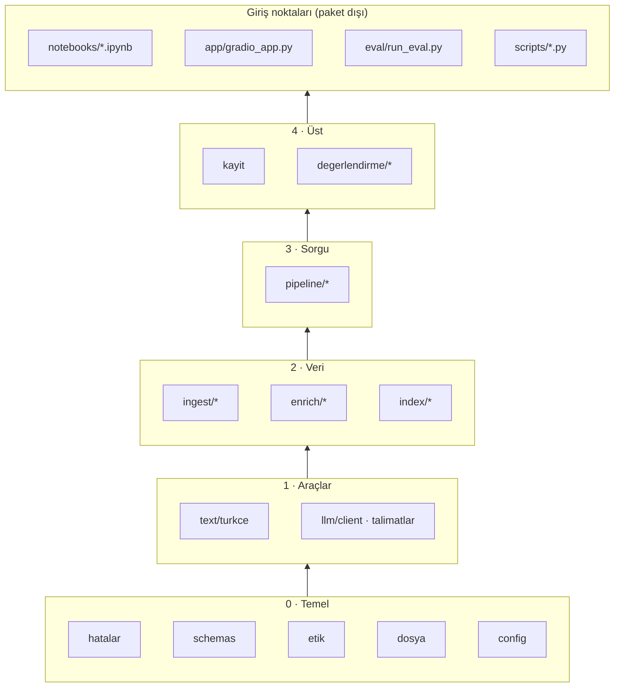
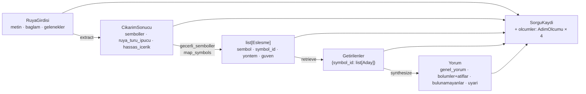
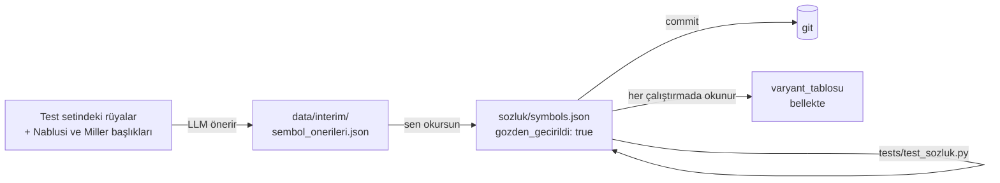

# 12 · Kod Yapısı ve Modül Sözleşmeleri

> Durum: v0.1 · Tarih: 23 Ekim 2026
> [03-mimari.md](03-mimari.md) sistemi **ne yaptığı** açısından anlatır: boru hattı, adımlar, ilkeler. Bu belge kodun **nasıl düzenlendiğini** anlatır: katmanlar, kim kimi çağırabilir, hangi modül hangi işlevi sunar, hangi dosyayı kim üretir.
> Buradaki kuralların çoğu testlerle korunur (`tests/test_mimari.py`). Kural değişirse önce bu belge, sonra test güncellenir.

## 1. Katmanlar ve bağımlılık kuralı

Kod beş katmandan oluşur. Bir modül yalnızca **kendi katmanındaki ya da altındaki** izinli birimleri içe aktarabilir. Yukarı doğru içe aktarma yoktur.



| Birim | İçe aktarabileceği `ruya` birimleri |
|---|---|
| `hatalar`, `schemas`, `etik`, `dosya` | — |
| `config` | `hatalar` |
| `text` | `config`, `hatalar` |
| `llm` | `config`, `hatalar`, `schemas` |
| `ingest` | temel katman, `text` |
| `enrich` | temel katman, `text`, `llm` |
| `index` | temel katman, `text` |
| `pipeline` | temel katman, `text`, `llm`, `index` · **`ingest` ve `enrich` yasak** |
| `kayit` | temel katman |
| `degerlendirme` | `kayit` dahil hepsi |

**Neden:** Çevrimdışı iş (ayrıştırma, zenginleştirme) ile çevrimiçi iş (sorgu) birbirine karışmasın (03, ilke 4). Sorgu kodu yalnızca hazırlanmış veriyi okur. Şemalar ve yapılandırma hiçbir şeye bağımlı olmadığı için her yerden güvenle kullanılır.

**Testlerle korunan diğer kurallar:**

- **Ağır paketler tembel yüklenir.** `chromadb`, `sentence_transformers`, `torch`, `transformers`, `gradio` ve `zeyrek` modül düzeyinde içe aktarılmaz; yalnızca onları kullanan işlevin içinde. Böylece bütün paket bilgisayarda, bu paketler kurulmadan içe aktarılabilir ve birim testleri çalışır (zeyrek kurulu ama analizörü yavaş yüklenir).
- **Göreli içe aktarma yok.** `from ..index import store` gibi satırlar katman testinden kaçabileceği için yasaktır; her zaman `from ruya.index import store` yazılır.
- **Model adları yalnızca `src/ruya/config.py` içinde.** `src/`, `app/`, `eval/`, `scripts/`, `notebooks/` altında başka bir dosyada `claude-…` ya da `deepseek-…` biçimli bir model adı geçemez.
- **Notebook'lar çıktısız commit edilir** ve ortak kurulum hücresiyle başlar.
- **`sozluk/symbols.json` her zaman şemaya uyar.**

## 2. Modül haritası

Durum: ✅ hazır ve testli · 🧩 arayüz hazır, gövde `NotImplementedError` · Hafta: [08](08-yol-haritasi-takvim.md)'deki takvim.

### Temel katman

| Modül | Sorumluluk | Ana öğeler | Durum |
|---|---|---|---|
| `config.py` | Veri yolları (`data/`), model adları, fiyatlar | `Ayarlar`, `ayarlar()`, `VERI_KLASORU`, `MODEL_*`, `LLM_ADRESI`, `LLM_ANAHTAR_DEGISKENI`, `FIYATLAR`, `SOZLUK_DOSYASI`, `TALIMAT_KLASORU` | ✅ |
| `hatalar.py` | Projeye özgü hatalar | `ApiAnahtariYok`, `ModelReddetti`, `YanitKesildi`, `SozlukHatasi` | ✅ |
| `schemas.py` | Bütün veri sözleşmeleri (bölüm 3) | `Madde`, `SymbolKaydi`, `RuyaGirdisi` … `SorguKaydi`, `TestOrnegi` | ✅ |
| `etik.py` | Sabit metinler | `UYARI_METNI`, `GUVENLIK_NOTU`, `SEMBOL_YOK_MESAJI`, `YASAK_IFADELER` | ✅ |
| `dosya.py` | JSONL okuma/yazma | `jsonl_oku(yol, sema)`, `jsonl_yaz(kayitlar, yol)`, `jsonl_ekle(dict, yol)` | ✅ |

### Araçlar

| Modül | Ana öğeler | Durum |
|---|---|---|
| `text/turkce.py` | `kucuk_harf`, `normallestir`, `kokler` | ✅ |
| `llm/client.py` | `LLMIstemcisi.mesaj(istek, ruya_icerir=False) -> LLMYaniti`, `.toplu(istekler, eszamanli=4) -> dict[str, LLMYaniti \| RuyaHatasi]` · `LLMYaniti.icerik`, `.json()` · `onbellek_anahtari` ✅ · `maliyet_hesapla` ✅ | 🔁 EVREN'e geçiş |
| `llm/talimatlar.py` | `talimat_oku("sentez_v1")` | ✅ |

### Veri hattı (çevrimdışı)

| Modül | Ana öğeler | Durum |
|---|---|---|
| `ingest/kaynaklar.py` | `KAYNAKLAR`: künye, lisans, URL, aşama. Tek doğru kaynak. | ✅ |
| `ingest/nablusi.py`, `miller.py`, `freud.py`, `ibn_sirin.py` | `ayristir(ham_dosya) -> Iterator[Madde]` | ✅ |
| `enrich/ceviri_birlestir.py` | `ceviri_oku`, `ceviriyi_uygula`: `data/interim/ceviri/` çıktılarını maddelere işler | ✅ |
| `enrich/sembol_ata.py` | `sembol_ata(maddeler, varyantlar)`: LLM'siz sembol atama | ✅ |
| `enrich/kosul_kurallari.py`, `yontem_kurallari.py`, `kapsam_kurallari.py` | `kosullari_cikar`, `yontemleri_cikar`, `kapsami_cikar`, `maddelere_uygula`: kural tabanlı koşul, yöntem ve kapsam etiketleri | ✅ |
| `index/build_symbols.py` | `sozlugu_yukle` ✅, `varyant_tablosu`, `sozluk_maddeler_tutarliligi` | ✅ |
| `index/store.py` | `MaddeDeposu`, `BellekDeposu` | ✅ |
| `index/parcalar.py`, `bm25.py`, `build_vectors.py` | Bölüm 5b | ✅ |

### Sorgu (çevrimiçi)

| Modül | İmza | Durum |
|---|---|---|
| `pipeline/extract.py` | `extract(girdi, istemci) -> (CikarimSonucu, Kullanim)` | ✅ |
| `pipeline/map.py` | `map_symbols(semboller, varyantlar, vektor=None, esik=0.8) -> list[Eslesme]` | ✅ |
| `pipeline/retrieve.py` | `retrieve(eslesmeler, depo, baglam, gelenekler, n) -> Getirilenler` | ✅ |
| `pipeline/synthesize.py` | `synthesize(cikarim, eslesmeler, getirilenler, baglam, istemci) -> (Yorum, Kullanim)` · paralel kipte sembol başına bir çağrı + genel yorum çağrısı; isteğe bağlı `ilerleme(bolumler)` her sembol bitince o ana kadarki bölümlerle (sembol sırasıyla) çağrılır; `Kullanim` çağrıların toplamıdır | ✅ |
| `pipeline/run.py` | `yorumla(girdi, bag, ilerleme=None) -> SorguKaydi` · `ilerleme(asama, kayit)` eşlemeden (`"esleme"`), getirmeden (`"getirme"`) sonra ve sentezde her sembol bitince (`"sentez"`, `kayit.yorum` o ana kadarki bölümler) çağrılır; kayıt kopyadır, `Bagimliliklar`, `varsayilan_bagimliliklar()` | ✅ |

### Üst katman ve giriş noktaları

| Modül | Ana öğeler | Durum |
|---|---|---|
| `kayit.py` | `sorgu_logla` (rüya metni olmadan), `gecmise_yaz` (yalnızca `RUYA_GECMIS=on`) | ✅ |
| `degerlendirme/metrikler.py` | `sembol_recall`, `sembol_precision`, `esleme_dogrulugu`, `recall_at_k`, `kaynak_cesitliligi`, `atif_kapsami`, `yasak_ifadeler` | ✅ |
| `degerlendirme/calistir.py` | `degerlendir(veri_seti, etiket, bag) -> rapor yolu` | ✅ |
| `app/gradio_app.py` | `arayuz_kur(bag)`, `baslat(bag)` (`share=False`), `yorum_akisi(girdi, bag)` (boru hattını ayrı iş parçacığında koşar, ara metinleri sırayla verir; Yorumla düğmesi bunu akıtır) | ✅ |
| `eval/run_eval.py` | CLI: `--dataset`, `--etiket` | ✅ (gövde `degerlendir`'e bağlı) |
| `scripts/download_sources.py` | CLI: `--asama`, `--kaynak`, `--yeniden` | ✅ |
| `notebooks/_kurulum.py` | Anahtar kontrolü, autoreload, yolların gösterimi | 🔁 bilgisayara uyarlanacak |

**Neden gövdeler boş?** Proje bir öğrenme projesi (H1): ayrıştırma, eşleme, getirme, sentez ve ölçütler takvimdeki haftalarda, belgeler okunarak yazılacak. Şimdi hazır olanlar, o işlerin üzerine oturacağı **sözleşmeler**: veri sınıfları, imzalar, yollar, kurallar ve onları koruyan testler. Her `NotImplementedError` mesajı hangi haftada yazılacağını söyler.

## 3. Veri sözleşmeleri

Bütün sınıflar `src/ruya/schemas.py` içinde, Pydantic v2 ile. Ortak kural: **bilinmeyen alan reddedilir** (`extra="forbid"`). Bir alanın adı yanlış yazılırsa sessizce kaybolmaz, hata verir.



| Sınıf | Nerede kullanılır | Önemli kurallar |
|---|---|---|
| `Madde` | `interim/*.jsonl`, `entries.jsonl` | `lisans` boş olamaz · `entry_id` = `<kaynak>:<yerel kimlik>` ve `kaynak` ile başlar · `ust_madde_id` aynı kaynaktan · `symbol_ids` ASCII küçük harf · `sembol_ar`, `sembol_tr` çevirinin önerdiği ham sembol adıdır, sözlük kimliği değildir |
| `SymbolKaydi` / `SozlukDosyasi` | `sozluk/symbols.json` | Anahtarlar `SYMBOL_ID_DESENI`'ne uyar · `gozden_gecirildi` varsayılan `False` |
| `RuyaGirdisi` | Arayüz → boru hattı | `metin` 1–3.000 karakter · `gelenekler=None` hepsi demek |
| `Sembol`, `CikarimSonucu` | Adım 1 | `olumsuz=True` semboller `gecerli_semboller`'e girmez · `ham_ifade` rüya metninin parçasıdır, loglanmaz |
| `Eslesme` | Adım 2 | `yontem="yok"` ⇔ `symbol_id=None` |
| `Aday` | Adım 3 | Madde + `skor` + `gerekceler` (hata ayıklama sekmesi için) |
| `Yorum`, `YorumBolumu`, `Atif` | Adım 4 | Her bölüm, modelin JSON çıktısındaki bir `bolumler` öğesidir ve kodda doğrulanmış atıflarını taşır (03, adım 4) · İG-32'deki yapı (sembol başlıkları, uzlaşı/ayrışma) metnin içinde Markdown başlıklarıyla taşınır · atıf kapsamında başlık bölümleri sayılmaz (06, bölüm 2) · `genel_yorum` (`str | None`) bölümleri birleştiren atıfsız düz paragraftır, arayüzde en başta gösterilir · `uyari` zorunlu |
| `Kullanim`, `AdimOlcumu` | Her adım | LLM adımlarında token ve maliyet; `talimat` alanı sürümü kaydeder (ör. `cikarim_v1`) |
| `SorguKaydi` | Arayüz, değerlendirme, log | `log_kaydi()` rüya metnini ve sembol ifadelerini **içermez** (testli) |
| `TestOrnegi` | `eval/dataset/*.jsonl` | `id` biçimi `r007` |

**03'ten bir fark:** 03'te getirme adımının çıktısı `dict[symbol_id, list[Madde]]` olarak geçiyor. Kodda maddeler `Aday` nesnesine sarıldı, çünkü hata ayıklama sekmesi (İG-42) skorları ve sıralama gerekçelerini de göstermek zorunda.

**Lisans kodları:** `PD` (kamu malı), `CC-BY-NC-SA-4.0`, `CC-BY-NC-4.0`, `CC-BY-SA-4.0`. Yeni bir kod gerekirse önce [KAYNAKLAR.md](KAYNAKLAR.md)'ye eklenir.

## 4. Bağımlılık enjeksiyonu

Boru hattı dış dünyaya (LLM API, madde deposu, sözlük, vektör indeksi) yalnızca tek bir nesne üzerinden erişir:

```python
@dataclass
class Bagimliliklar:
    istemci: LLMIstemcisi
    varyantlar: dict[str, str]       # normalleştirilmiş ad/varyant → symbol_id
    depo: MaddeDeposu                # Protocol: sembolun_maddeleri, madde
    hibrit: HibritIndeks | None      # indeks yoksa sözlük yolu
    ayar: Ayarlar
```

- **Gerçek çalıştırmada:** `varsayilan_bagimliliklar()` sözlüğü repodan, maddeleri `data/`'dan okur, istemciyi kurar. Arayüz notebook'u ve değerlendirme bunu çağırır.
- **Testlerde:** Sahte (fake) depo ve sahte istemci verilir; API çağrılmaz, para harcanmaz. `tests/test_run.py` bu yolla orkestrasyonu sınar.

Adım işlevleri `run.py`'den modül üzerinden çağrılır (`extract.extract(...)`). Böylece testte tek bir adım sahtesiyle değiştirilebilir.

## 5. Veri ürünleri: kim üretir, kim okur, nerede durur

| Dosya | Üreten | Okuyan | Yer | Şema |
|---|---|---|---|---|
| `data/raw/<kaynak>.txt` | `scripts/download_sources.py` | `ingest/*` | `data/` | ham |
| `data/raw/KAYNAK_OZETLERI.json` | `download_sources.py` | sen (değişiklik kontrolü) | `data/` | URL, lisans, bayt, SHA256 |
| `data/interim/<kaynak>.jsonl` | `ingest/<kaynak>.py` | `enrich/*` | `data/` | `Madde` (çeviri ve koşul alanları boş) |
| `data/processed/entries.jsonl` | `scripts/maddeleri_kur.py` (ayrıştırma + çeviri), sonra `enrich/*` | `index/*`, `pipeline/` | `data/` | `Madde` |
| `sozluk/symbols.json` | **sen** (elle onay) | `index/build_symbols.py` | **git** | `SozlukDosyasi` |
| `data/index/hibrit/` | `scripts/hibrit_indeks_kur.py` | `index/build_vectors.py` | `data/` | parçalar, BM25, numpy vektörler, manifest |
| `data/cache/llm/<sha256>.json` | `llm/client.py` | `llm/client.py` | `data/` | SDK yanıtı + kullanım · rüya içeren istekler yalnızca `RUYA_SORGU_ONBELLEGI=on` iken (03, bölüm 5.2) |
| `data/logs/sorgular.jsonl` | `kayit.sorgu_logla` | sen | `data/` | `SorguKaydi.log_kaydi()` |
| `data/gecmis/<yıl-ay>.jsonl` | `kayit.gecmise_yaz` | sen | `data/` (isteğe bağlı) | `SorguKaydi` |
| `data/raporlar/<tarih>_<etiket>.md` | `degerlendirme/calistir.py` | sen | `data/` | Markdown |
| `docs/olcumler.md` | **sen** (özet satırı) | — | **git** | tablo |
| `eval/dataset/ruyalar_v1.jsonl` | **sen** | `degerlendirme/` | **git** (özel repo) | `TestOrnegi` |

**Sözlükten türeyen tablolar diskte tutulmaz.** Varyant tablosu (ad → `symbol_id`) ve sembol → madde tablosu her oturum başında bellekte kurulur. 50–150 sembol ve ~10 bin madde için bu bir saniyeden kısa sürer. Böylece "diskteki tablo eski kaldı" türünden bir hata hiç oluşmaz. `data/index/` klasöründe yalnızca Chroma indeksi durur.

### Sembol sözlüğünün yaşam döngüsü



1. **Öneri:** LLM sembol ve varyant önerir; öneriler `data/interim/` altına yazılır, repoya doğrudan girmez.
2. **Onay:** Sen `symbols.json`'a eklersin ya da düzeltirsin, `gozden_gecirildi: true` yaparsın.
3. **Doğrulama:** `uv run pytest tests/test_sozluk.py`, ardından commit. Bir varyantın iki sembolde birden geçmesi `varyant_tablosu` tarafından hata olarak yakalanır.
4. **Tutarlılık:** Zenginleştirmeden sonra `sozluk_maddeler_tutarliligi` sözlükte olmayan `symbol_id`'leri ve hiç maddesi olmayan onaylı sembolleri listeler.

## 5b. Hibrit getirme birimleri

Tasarım: [13](13-hibrit-getirme.md).

| Modül | Arayüz |
|---|---|
| `llm/client.py` | `gom(metinler, ruya_icerir)`, `yeniden_sirala(sorgu, belgeler, ruya_icerir)`, `ocr(veri, mime)`; önbelleğe yazmazlar |
| `text/turkce.py` | `arama_terimleri(metin) -> list[str]` |
| `index/parcalar.py` | `Parca`, `parcala(maddeler) -> list[Parca]` |
| `index/bm25.py` | `Bm25Indeksi`: `kur`, `ara(terimler, k)`, `kaydet`, `yukle` |
| `index/build_vectors.py` | `VektorDeposu` (numpy), `hibrit_indeks_kur(...)`, `HibritIndeks.yukle(klasor)` |
| `pipeline/hibrit.py` | `getirme_sorgusu`, `rrf`, `hibrit_getir(...) -> Getirilenler` |
| `enrich/kosul_kurallari.py` | `kosullari_cikar(metin_tr) -> list[Kosul]`, `maddelere_uygula(maddeler)` |

`Getirilenler` anahtarı `symbol_id` ya da `serbest:<ad>`; ortak işlev `schemas.getirme_anahtari(eslesme)`.

## 6. Talimat (prompt) sürümleme

- Talimatlar `prompts/<is>_v<n>.md` dosyalarında durur; kod `talimat_oku("<is>_v<n>")` ile okur.
- Her modülün kullandığı sürüm bir sabitte yazılıdır (`extract.TALIMAT = "cikarim_v1"`). Bu ad `AdimOlcumu.talimat` alanıyla her sorgu kaydına ve loga geçer.
- Bir ölçüm raporunda kullanılmış talimat dosyası **değiştirilmez**; yeni sürüm yeni dosyadır. Böylece "v1 ile v2 arasında ne değişti?" sorusu hem git'te hem ölçüm tablosunda cevaplanabilir.
- Ayrıntılar ve planlanan talimatlar: [`prompts/README.md`](../prompts/README.md).

## 7. Hata yönetimi

| Hata | Kim fırlatır | Arayüzün davranışı (03, bölüm 5.4) |
|---|---|---|
| `ApiAnahtariYok` | `LLMIstemcisi` | Açılışta net mesaj |
| `ModelReddetti` | `LLMIstemcisi` (`message.refusal` dolu) | `etik.REDDEDILDI_MESAJI`, olay loglanır |
| `YanitKesildi` | `LLMIstemcisi` (`finish_reason == "length"`) | Loglanır; `max_tokens` artırılır |
| `SozlukHatasi` | `index/build_symbols.py` | Açılışta net mesaj |
| `YanitBozuk` | `LLMYaniti.json()` | JSON şeması istenen yanıt ayrıştırılamadı; loglanır, istek bir kez yeniden denenebilir |
| `LLMHatasi` | `LLMIstemcisi` | 429, 5xx ve "model dolu" yanıtları en fazla 4 kez denendikten sonra ya da tekrarlanmayan bir 4xx'te; HTTP durumu ve geçidin mesajı gösterilir |

"Sembol bulunamadı" ve "maddesi yok" hata değildir: `SorguKaydi.mesaj` ve `Yorum.bulunamayanlar` ile normal akışta taşınır.

## 8. Adlandırma ve kod düzeni

- **Tanımlayıcılar Türkçe, ASCII:** `kucuk_harf`, `SorguKaydi`, `gozden_gecirildi` (ç→c, ğ→g, ı→i, ö→o, ş→s, ü→u). Boru hattı adımlarının modül ve işlev adları 03'teki gibi İngilizce kalır (`extract`, `map_symbols`, `retrieve`, `synthesize`); belgelerle aynı ad kullanılsın diye.
- **Yorum ve docstring'ler Türkçe.** Docstring, işlevin hangi belgeye ve gereksinime dayandığını söyler (ör. "İG-22").
- **`symbol_id`:** ASCII, küçük harf, kelimeler alt çizgiyle: `yilan`, `olmus_baba`.
- **`entry_id`:** `<kaynak>:<yerel kimlik>`; yerel kimlik kaynak satır numarasından türetilir (6 hane, ör. `nablusi:004310`). Yeniden ayrıştırmada değişmez.
- **Dosya ve klasör adları:** Türkçe karakter yok.
- **Biçim:** ruff (satır uzunluğu 100). `uv run ruff check . && uv run ruff format .`

## 9. Günlük geliştirme döngüsü

```
1. docs/ altındaki ilgili belgeyi oku
2. Testi yaz (tests/fixtures ile)
3. Kodu yaz → uv run pytest
4. uv run ruff check . && uv run ruff format .
5. Gerçek veriyle çalıştır (betik ya da notebook); çıktı data/ altına yazılır
6. Gerekirse: uv run pytest -m veri
7. git commit (atomik, Türkçe); push (sen)
```

Mantık notebook'ta birikmeye başlarsa `src/ruya/` altına taşı ve test et.

## 10. Yeni bir kaynak eklemek (kontrol listesi)

1. Lisansı doğrula; [07](07-etik-ve-hukuk.md)'deki V1–V4'e uyuyor mu?
2. [KAYNAKLAR.md](KAYNAKLAR.md)'ye künye, lisans ve atıf metnini ekle.
3. `ingest/kaynaklar.py` → `KAYNAKLAR` sözlüğüne `KaynakBilgisi` ekle. Adres sabit bir sürümü göstermeli (git deposuysa commit; değilse ilk indirmeden sonra `sha256` alanı doldurulur). Neden: `entry_id` satır numarasına bağlı ([02](02-veri-kaynaklari-ve-semasi.md), bölüm 4.1).
4. `tests/fixtures/` altına ham dosyadan birkaç satır koy (kaynağı ve lisansı dosyanın başında yaz).
5. `ingest/<kaynak>.py` içinde `ayristir` işlevini yaz, testini yaz.
6. İndir → ayrıştır → zenginleştir → `entries.jsonl`; `uv run pytest -m veri`.
7. Gerekirse `schemas.Gelenek` ve `Dil` türlerini genişlet.
