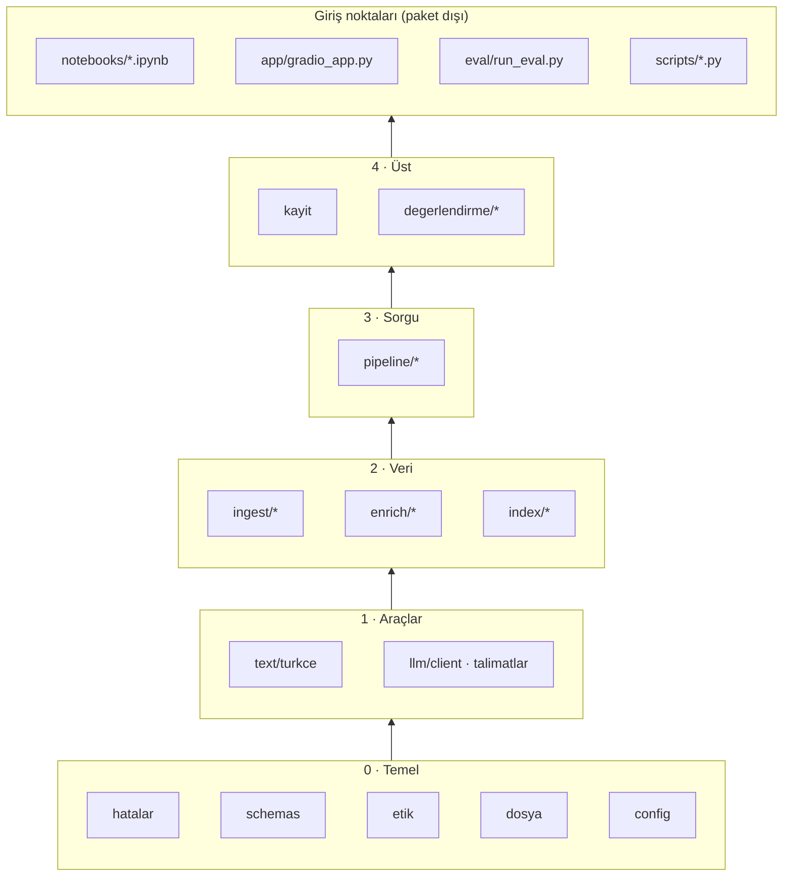
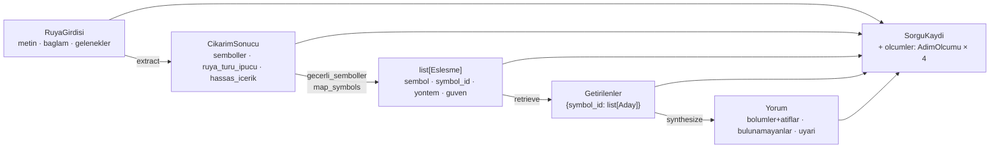
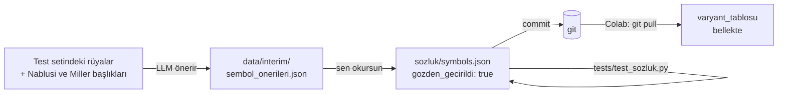

# 12 · Kod Yapısı ve Modül Sözleşmeleri

> Durum: v0.1 · Tarih: 23 Ekim 2026
> [03-mimari.md](03-mimari.md) sistemi **ne yaptığı** açısından anlatır: boru hattı, adımlar, ilkeler. Bu belge kodun **nasıl düzenlendiğini** anlatır: katmanlar, kim kimi çağırabilir, hangi modül hangi işlevi sunar, hangi dosyayı kim üretir.
> Buradaki kuralların çoğu testlerle korunur (`tests/test_mimari.py`). Kural değişirse önce bu belge, sonra test güncellenir.

## 1. Katmanlar ve bağımlılık kuralı

Kod beş katmandan oluşur. Bir modül yalnızca **kendi katmanındaki ya da altındaki** izinli birimleri içe aktarabilir. Yukarı doğru içe aktarma yoktur.



| Birim | İçe aktarabileceği `ruya` birimleri |
|---|---|
| `hatalar`, `schemas`, `etik`, `dosya` | — |
| `config` | `hatalar` |
| `text` | `config`, `hatalar` |
| `llm` | `config`, `hatalar`, `schemas` |
| `ingest` | temel katman, `text` |
| `enrich` | temel katman, `text`, `llm` |
| `index` | temel katman, `text` |
| `pipeline` | temel katman, `text`, `llm`, `index` · **`ingest` ve `enrich` yasak** |
| `kayit` | temel katman |
| `degerlendirme` | `kayit` dahil hepsi |

**Neden:** Çevrimdışı iş (ayrıştırma, zenginleştirme) ile çevrimiçi iş (sorgu) birbirine karışmasın (03, ilke 4). Sorgu kodu yalnızca hazırlanmış veriyi okur. Şemalar ve yapılandırma hiçbir şeye bağımlı olmadığı için her yerden güvenle kullanılır.

**Testlerle korunan diğer kurallar:**

- **Ağır paketler tembel yüklenir.** `chromadb`, `sentence_transformers`, `torch`, `transformers`, `gradio` ve `google.colab` modül düzeyinde içe aktarılmaz; yalnızca onları kullanan işlevin içinde. Böylece bütün paket bilgisayarda, bu paketler kurulmadan içe aktarılabilir ve birim testleri çalışır.
- **Model adları yalnızca `src/ruya/config.py` içinde.** `src/`, `app/`, `eval/`, `scripts/`, `notebooks/` altında başka bir dosyada `claude-…` geçemez.
- **Notebook'lar çıktısız commit edilir** ve ortak kurulum hücresiyle başlar.
- **`sozluk/symbols.json` her zaman şemaya uyar.**

## 2. Modül haritası

Durum: ✅ hazır ve testli · 🧩 arayüz hazır, gövde `NotImplementedError` · Hafta: [08](08-yol-haritasi-takvim.md)'deki takvim.

### Temel katman

| Modül | Sorumluluk | Ana öğeler | Durum |
|---|---|---|---|
| `config.py` | Ortam algılama, yollar, model adları, fiyatlar | `Ayarlar`, `ayarlar()`, `colabda_mi()`, `MODEL_*`, `EFFORT_*`, `FIYATLAR`, `SOZLUK_DOSYASI`, `TALIMAT_KLASORU` | ✅ |
| `hatalar.py` | Projeye özgü hatalar | `VeriYoluYok`, `ApiAnahtariYok`, `ModelReddetti`, `YanitKesildi`, `SozlukHatasi` | ✅ |
| `schemas.py` | Bütün veri sözleşmeleri (bölüm 3) | `Madde`, `SymbolKaydi`, `RuyaGirdisi` … `SorguKaydi`, `TestOrnegi` | ✅ |
| `etik.py` | Sabit metinler | `UYARI_METNI`, `GUVENLIK_NOTU`, `SEMBOL_YOK_MESAJI`, `YASAK_IFADELER` | ✅ |
| `dosya.py` | JSONL okuma/yazma | `jsonl_oku(yol, sema)`, `jsonl_yaz(kayitlar, yol)`, `jsonl_ekle(dict, yol)` | ✅ |

### Araçlar

| Modül | Ana öğeler | Durum |
|---|---|---|
| `text/turkce.py` | `kucuk_harf`, `normallestir`, `kokler` | 🧩 Hafta 2, 4 |
| `llm/client.py` | `LLMIstemcisi.mesaj(istek, ruya_icerir=False)`, `.batch_gonder`, `.batch_sonuclari` · `onbellek_anahtari` ✅ · `maliyet_hesapla` ✅ | 🧩 Hafta 3–4 |
| `llm/talimatlar.py` | `talimat_oku("sentez_v1")` | ✅ |

### Veri hattı (çevrimdışı)

| Modül | Ana öğeler | Durum |
|---|---|---|
| `ingest/kaynaklar.py` | `KAYNAKLAR`: künye, lisans, URL, aşama. Tek doğru kaynak. | ✅ |
| `ingest/nablusi.py`, `miller.py` | `ayristir(ham_dosya) -> Iterator[Madde]` | 🧩 Hafta 2 |
| `ingest/freud.py`, `ibn_sirin.py` | aynı arayüz | 🧩 Hafta 7, 8 |
| `enrich/assign_symbols.py`, `translate.py` | `batch_istekleri(...)`, `sonuclari_uygula(maddeler, yanitlar)` | 🧩 Hafta 3 |
| `enrich/conditions.py` | aynı arayüz | 🧩 Hafta 8 |
| `index/build_symbols.py` | `sozlugu_yukle` ✅, `varyant_tablosu`, `sozluk_maddeler_tutarliligi` | 🧩 Hafta 3–4 |
| `index/store.py` | `MaddeDeposu`, `VektorArayici` (Protocol) ✅, `BellekDeposu` | 🧩 Hafta 4 |
| `index/build_vectors.py`, `yedek.py` | `vektor_indeksi_kur`, `ChromaVektorArayici`, `indeksi_yedekle/geri_yukle` | 🧩 Hafta 6 |

### Sorgu (çevrimiçi)

| Modül | İmza | Durum |
|---|---|---|
| `pipeline/extract.py` | `extract(girdi, istemci) -> (CikarimSonucu, Kullanim)` | 🧩 Hafta 4 |
| `pipeline/map.py` | `map_symbols(semboller, varyantlar, vektor=None, esik=0.8) -> list[Eslesme]` | 🧩 Hafta 4 |
| `pipeline/retrieve.py` | `retrieve(eslesmeler, depo, baglam, gelenekler, n) -> Getirilenler` | 🧩 Hafta 4 |
| `pipeline/synthesize.py` | `synthesize(cikarim, eslesmeler, getirilenler, baglam, istemci) -> (Yorum, Kullanim)` | 🧩 Hafta 5 |
| `pipeline/run.py` | `yorumla(girdi, bag) -> SorguKaydi`, `Bagimliliklar`, `varsayilan_bagimliliklar()` | ✅ |

### Üst katman ve giriş noktaları

| Modül | Ana öğeler | Durum |
|---|---|---|
| `kayit.py` | `sorgu_logla` (rüya metni olmadan), `gecmise_yaz` (yalnızca `RUYA_GECMIS=on`) | ✅ |
| `degerlendirme/metrikler.py` | `sembol_recall`, `sembol_precision`, `esleme_dogrulugu`, `recall_at_k`, `kaynak_cesitliligi`, `atif_kapsami`, `yasak_ifadeler` | 🧩 Hafta 5 |
| `degerlendirme/calistir.py` | `degerlendir(veri_seti, etiket, bag) -> rapor yolu` | 🧩 Hafta 5 |
| `app/gradio_app.py` | `arayuz_kur(bag)`, `baslat(bag)` (`share=False`) | 🧩 Hafta 5 |
| `eval/run_eval.py` | CLI: `--dataset`, `--etiket` | ✅ (gövde `degerlendir`'e bağlı) |
| `scripts/download_sources.py` | CLI: `--asama`, `--kaynak`, `--yeniden` | ✅ |
| `notebooks/_kurulum.py` | Drive, Secrets, git pull, pip install, ortam değişkenleri | ✅ |

**Neden gövdeler boş?** Proje bir öğrenme projesi (H1): ayrıştırma, eşleme, getirme, sentez ve ölçütler takvimdeki haftalarda, belgeler okunarak yazılacak. Şimdi hazır olanlar, o işlerin üzerine oturacağı **sözleşmeler**: veri sınıfları, imzalar, yollar, kurallar ve onları koruyan testler. Her `NotImplementedError` mesajı hangi haftada yazılacağını söyler.

## 3. Veri sözleşmeleri

Bütün sınıflar `src/ruya/schemas.py` içinde, Pydantic v2 ile. Ortak kural: **bilinmeyen alan reddedilir** (`extra="forbid"`). Bir alanın adı yanlış yazılırsa sessizce kaybolmaz, hata verir.



| Sınıf | Nerede kullanılır | Önemli kurallar |
|---|---|---|
| `Madde` | `interim/*.jsonl`, `entries.jsonl` | `lisans` boş olamaz · `entry_id` = `<kaynak>:<yerel kimlik>` ve `kaynak` ile başlar · `ust_madde_id` aynı kaynaktan · `symbol_ids` ASCII küçük harf |
| `SymbolKaydi` / `SozlukDosyasi` | `sozluk/symbols.json` | Anahtarlar `SYMBOL_ID_DESENI`'ne uyar · `gozden_gecirildi` varsayılan `False` |
| `RuyaGirdisi` | Arayüz → boru hattı | `metin` 1–3.000 karakter · `gelenekler=None` hepsi demek |
| `Sembol`, `CikarimSonucu` | Adım 1 | `olumsuz=True` semboller `gecerli_semboller`'e girmez · `ham_ifade` rüya metninin parçasıdır, loglanmaz |
| `Eslesme` | Adım 2 | `yontem="yok"` ⇔ `symbol_id=None` |
| `Aday` | Adım 3 | Madde + `skor` + `gerekceler` (hata ayıklama sekmesi için) |
| `Yorum`, `YorumBolumu`, `Atif` | Adım 4 | Her bölüm kendi atıflarını taşır · `uyari` zorunlu |
| `Kullanim`, `AdimOlcumu` | Her adım | LLM adımlarında token ve maliyet; `talimat` alanı sürümü kaydeder (ör. `cikarim_v1`) |
| `SorguKaydi` | Arayüz, değerlendirme, log | `log_kaydi()` rüya metnini ve sembol ifadelerini **içermez** (testli) |
| `TestOrnegi` | `eval/dataset/*.jsonl` | `id` biçimi `r007` |

**03'ten bir fark:** 03'te getirme adımının çıktısı `dict[symbol_id, list[Madde]]` olarak geçiyor. Kodda maddeler `Aday` nesnesine sarıldı, çünkü hata ayıklama sekmesi (İG-42) skorları ve sıralama gerekçelerini de göstermek zorunda.

**Lisans kodları:** `PD` (kamu malı), `CC-BY-NC-SA-4.0`, `CC-BY-NC-4.0`, `CC-BY-SA-4.0`. Yeni bir kod gerekirse önce [KAYNAKLAR.md](KAYNAKLAR.md)'ye eklenir.

## 4. Bağımlılık enjeksiyonu

Boru hattı dış dünyaya (Claude API, madde deposu, sözlük, vektör indeksi) yalnızca tek bir nesne üzerinden erişir:

```python
@dataclass
class Bagimliliklar:
    istemci: LLMIstemcisi
    varyantlar: dict[str, str]       # normalleştirilmiş ad/varyant → symbol_id
    depo: MaddeDeposu                # Protocol: sembolun_maddeleri, madde
    vektor: VektorArayici | None     # Aşama 2
    ayar: Ayarlar
```

- **Colab'de:** `varsayilan_bagimliliklar()` sözlüğü repodan, maddeleri Drive'dan okur, istemciyi kurar. Arayüz notebook'u ve değerlendirme bunu çağırır.
- **Testlerde:** Sahte (fake) depo ve sahte istemci verilir; API çağrılmaz, para harcanmaz. `tests/test_run.py` bu yolla orkestrasyonu sınar.
- **Aşama 2'de:** `BellekDeposu` yerine Chroma'lı bir depo, `vektor` alanına `ChromaVektorArayici` takılır. `pipeline/` kodu değişmez; çünkü somut sınıfları değil `store.py`'deki Protocol'leri bilir.

Adım işlevleri `run.py`'den modül üzerinden çağrılır (`extract.extract(...)`). Böylece testte tek bir adım sahtesiyle değiştirilebilir.

## 5. Veri ürünleri: kim üretir, kim okur, nerede durur

| Dosya | Üreten | Okuyan | Yer | Şema |
|---|---|---|---|---|
| `data/raw/<kaynak>.txt` | `scripts/download_sources.py` | `ingest/*` | Drive | ham |
| `data/raw/KAYNAK_OZETLERI.json` | `download_sources.py` | sen (değişiklik kontrolü) | Drive | URL, lisans, bayt, SHA256 |
| `data/interim/<kaynak>.jsonl` | `ingest/<kaynak>.py` | `enrich/*` | Drive | `Madde` (çeviri ve koşul alanları boş) |
| `data/interim/sembol_onerileri.json` | `enrich/assign_symbols.py` | sen (gözden geçirme) | Drive | serbest |
| `data/processed/entries.jsonl` | `enrich/*` (son adım) | `index/*`, `pipeline/` | Drive | `Madde` |
| `sozluk/symbols.json` | **sen** (elle onay) | `index/build_symbols.py` | **git** | `SozlukDosyasi` |
| `data/index/chroma.zip` | `index/yedek.py` | `index/yedek.py` | Drive (yedek) | Chroma |
| `/content/calisma/chroma/` | `index/build_vectors.py` | `index/*` | Colab yerel diski (geçici) | Chroma |
| `cache/llm/<sha256>.json` | `llm/client.py` | `llm/client.py` | Drive | SDK yanıtı + kullanım · rüya içeren istekler yalnızca `RUYA_SORGU_ONBELLEGI=on` iken (03, bölüm 5.2) |
| `cache/batch/<etiket>.json` | `LLMIstemcisi.batch_gonder` | `batch_sonuclari` | Drive | batch kimliği, durum |
| `logs/sorgular.jsonl` | `kayit.sorgu_logla` | sen | Drive | `SorguKaydi.log_kaydi()` |
| `gecmis/<yıl-ay>.jsonl` | `kayit.gecmise_yaz` | sen | Drive (isteğe bağlı) | `SorguKaydi` |
| `raporlar/<tarih>_<etiket>.md` | `degerlendirme/calistir.py` | sen | Drive | Markdown |
| `docs/olcumler.md` | **sen** (özet satırı) | — | **git** | tablo |
| `eval/dataset/ruyalar_v1.jsonl` | **sen** | `degerlendirme/` | **git** (özel repo) | `TestOrnegi` |

**Sözlükten türeyen tablolar diskte tutulmaz.** Varyant tablosu (ad → `symbol_id`) ve sembol → madde tablosu her oturum başında bellekte kurulur. 50–150 sembol ve ~10 bin madde için bu bir saniyeden kısa sürer. Böylece "Drive'daki tablo eski kaldı" türünden bir hata hiç oluşmaz. Drive'daki `data/index/` klasöründe yalnızca Chroma yedeği durur.

### Sembol sözlüğünün yaşam döngüsü



1. **Öneri:** LLM sembol ve varyant önerir; öneriler Drive'a yazılır, repoya doğrudan girmez.
2. **Onay:** Sen `symbols.json`'a eklersin ya da düzeltirsin, `gozden_gecirildi: true` yaparsın.
3. **Doğrulama:** `uv run pytest tests/test_sozluk.py`, ardından commit. Bir varyantın iki sembolde birden geçmesi `varyant_tablosu` tarafından hata olarak yakalanır.
4. **Tutarlılık:** Zenginleştirmeden sonra `sozluk_maddeler_tutarliligi` sözlükte olmayan `symbol_id`'leri ve hiç maddesi olmayan onaylı sembolleri listeler.

## 6. Talimat (prompt) sürümleme

- Talimatlar `prompts/<is>_v<n>.md` dosyalarında durur; kod `talimat_oku("<is>_v<n>")` ile okur.
- Her modülün kullandığı sürüm bir sabitte yazılıdır (`extract.TALIMAT = "cikarim_v1"`). Bu ad `AdimOlcumu.talimat` alanıyla her sorgu kaydına ve loga geçer.
- Bir ölçüm raporunda kullanılmış talimat dosyası **değiştirilmez**; yeni sürüm yeni dosyadır. Böylece "v1 ile v2 arasında ne değişti?" sorusu hem git'te hem ölçüm tablosunda cevaplanabilir.
- Ayrıntılar ve planlanan talimatlar: [`prompts/README.md`](../prompts/README.md).

## 7. Hata yönetimi

| Hata | Kim fırlatır | Arayüzün davranışı (03, bölüm 5.4) |
|---|---|---|
| `VeriYoluYok` | `Ayarlar.veri()` | Bilgisayarda beklenen durum; Colab'de kurulum hücresi çalıştırılmamış demektir |
| `ApiAnahtariYok` | `LLMIstemcisi` | Açılışta net mesaj |
| `ModelReddetti` | `LLMIstemcisi` (`stop_reason == "refusal"`) | `etik.REDDEDILDI_MESAJI`, olay loglanır |
| `YanitKesildi` | `LLMIstemcisi` (`stop_reason == "max_tokens"`) | Loglanır; `max_tokens` artırılır |
| `SozlukHatasi` | `index/build_symbols.py` | Açılışta net mesaj |
| `anthropic.*Error` | SDK | 429 ve 5xx'i SDK yeniden dener; 400 tekrarlanmaz, mesajı gösterilir |

"Sembol bulunamadı" ve "maddesi yok" hata değildir: `SorguKaydi.mesaj` ve `Yorum.bulunamayanlar` ile normal akışta taşınır.

## 8. Adlandırma ve kod düzeni

- **Tanımlayıcılar Türkçe, ASCII:** `kucuk_harf`, `SorguKaydi`, `gozden_gecirildi` (ç→c, ğ→g, ı→i, ö→o, ş→s, ü→u). Boru hattı adımlarının modül ve işlev adları 03'teki gibi İngilizce kalır (`extract`, `map_symbols`, `retrieve`, `synthesize`); belgelerle aynı ad kullanılsın diye.
- **Yorum ve docstring'ler Türkçe.** Docstring, işlevin hangi belgeye ve gereksinime dayandığını söyler (ör. "İG-22").
- **`symbol_id`:** ASCII, küçük harf, kelimeler alt çizgiyle: `yilan`, `olmus_baba`.
- **`entry_id`:** `<kaynak>:<yerel kimlik>`; yerel kimlik kaynak satır numarasından türetilir (6 hane, ör. `nablusi:004310`). Yeniden ayrıştırmada değişmez.
- **Dosya ve klasör adları:** Türkçe karakter yok.
- **Biçim:** ruff (satır uzunluğu 100). `uv run ruff check . && uv run ruff format .`

## 9. Günlük geliştirme döngüsü

```
Bilgisayar (VS Code)                        Colab
────────────────────                        ─────
1. docs/ altındaki ilgili belgeyi oku
2. Testi yaz (tests/fixtures ile)
3. Kodu yaz → uv run pytest
4. uv run ruff check . && uv run ruff format .
5. git commit (atomik, Türkçe)
6. push (sen)                       ──▶     7. Notebook'un kurulum hücresi: git pull
                                            8. Gerçek veriyle çalıştır, çıktıyı Drive'a yaz
                                            9. Gerekirse: python -m pytest -m veri
```

Küçük bir değişikliği Colab'de görmek 5 dakikadan uzun sürüyorsa (R12) mantık notebook'ta birikmiş demektir; `src/ruya/` altına taşı ve bilgisayarda test et.

## 10. Yeni bir kaynak eklemek (kontrol listesi)

1. Lisansı doğrula; [07](07-etik-ve-hukuk.md)'deki V1–V4'e uyuyor mu?
2. [KAYNAKLAR.md](KAYNAKLAR.md)'ye künye, lisans ve atıf metnini ekle.
3. `ingest/kaynaklar.py` → `KAYNAKLAR` sözlüğüne `KaynakBilgisi` ekle. Adres sabit bir sürümü göstermeli (git deposuysa commit; değilse ilk indirmeden sonra `sha256` alanı doldurulur). Neden: `entry_id` satır numarasına bağlı ([02](02-veri-kaynaklari-ve-semasi.md), bölüm 4.1).
4. `tests/fixtures/` altına ham dosyadan birkaç satır koy (kaynağı ve lisansı dosyanın başında yaz).
5. `ingest/<kaynak>.py` içinde `ayristir` işlevini yaz, testini yaz.
6. Colab'de: indir → ayrıştır → zenginleştir → `entries.jsonl`; `pytest -m veri`.
7. Gerekirse `schemas.Gelenek` ve `Dil` türlerini genişlet.
